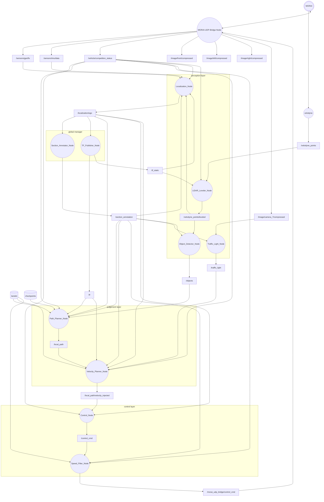

# MORAI-Autonomous-Driving-System

MORAI SIM 기반 자율주행 시스템. ROS 1 Noetic을 사용한다.

## Convention

### 협업과 Core 작성

이 프로젝트는 Strategy 패턴으로 작성하며, 알고리즘 Core와 ROS 실행 Pipeline을 분리해 협업한다.

- 각 파트 담당자는 노드를 직접 개발하지 않고 자신의 Core만 작성한다. 사전 협의 없이 Core 외부 코드를 수정하거나 외부 코드에 접근하지 않는다.
- 리드 개발자는 Pipeline 라이브러리와 템플릿을 따르는 노드를 제공하고, 담당자가 작성한 Core를 ROS 입출력에 연결한다.
- Core는 정규 `process()` 호출과 그 인자·반환값 이외에 외부와 커플링을 만들지 않는 샌드박스다. ROS 구독·발행, 외부 객체 호출, 공유 상태 접근 등 외부 연결을 Core 안에 만들지 않는다.
- Core는 알고리즘 계산과 내부 계산 상태만 갖는 단순한 알고리즘 캐리어다. 내부에서 데이터의 valid 검사, 누락 대응, fallback, 처리 성공·실패 판정을 하지 않는다. 입력 검사와 처리 정책은 Pipeline이 담당한다.
- Core 하나당 파일 하나를 두고, 실제 입력 메시지를 `process()`의 개별 인자로 받는다. 목표 발행 메시지 타입의 payload를 완성해 반환하며, 출력 헤더 주입과 발행은 Pipeline이 담당한다.

구체적인 입출력 계약과 작성 방식은 [node_pipeline 가이드](src/node_pipeline/README.md)와
그 안의 [템플릿 코드](src/node_pipeline/templates/)를 참고한다.
개발 단계에서 데모 테스트가 필요하면 먼저 노드의 `core_set.hpp`에서 Core 파일을
include하고 Core ID·객체·필수 입력·`process()` 인자 연결을 등록한다.
이후 각 패키지의 `config/<package_name>.yaml`에서 Core 매핑을 변경해
등록한 Core를 바꿔 끼우며 개발한다. CoreSet 등록은 리드 개발자와 협의해 진행한다.
각 노드의 등록 파일은 `include/<package_name>/core_set.hpp`,
Core 작성 위치는 `include/<package_name>/cores/`다.

### 좌표계

#### 글로벌 좌표계 — `map`

지도에 고정된 좌표계이다. WGS84 / UTM zone 52N (`EPSG:32652`)에서
지도 원점 `(E₀, N₀, Z₀) = (302595.0, 4124145.0, 0.0)`을 차감해 사용한다.

| 항목 | 규약 |
|---|---|
| 원점 | 위 UTM 좌표에 해당하는 지도 기준점 |
| 축 | `+x` UTM 격자 동쪽, `+y` 격자 북쪽, `+z` 위쪽 |
| 단위 | m |
| 적용 대상 | 지도, 체크포인트, `/localization/ego`, `/local_path` |

GPS 위경도는 WGS84에서 UTM 52N으로 투영한 뒤 다음과 같이 변환한다.
격자 북쪽과 진북은 구분한다.

```text
x = Easting  - 302595.0
y = Northing - 4124145.0
```

- `checkpoints.csv`의 `x, y`와 `kcity_lanelet2.osm`의 `local_x, local_y`는 이 좌표계이다.
- OSM의 `lon, lat`은 WGS84 위경도이다. 각 노드의 추가 속성인
  `<tag k="local_x" v="..."/>`, `local_y`, `local_z`에는 지도 원점을 차감한
  `map` 좌표가 저장되어 있다. 이 이름의 `local`은 차량 `base_link`를 뜻하지 않는다.
- 전역 데이터의 Header는 `frame_id=map`으로 사용한다. `/localization/ego`는
  `geometry_msgs/PoseStamped`로 차량 기준점의 위치·자세와 추정 기준 시각을 발행한다.
- 지도·체크포인트의 원본 z는 보존한다. 수직 기준면과 GPS 고도와의 관계는 아직 미확정이다.

#### Quaternion 규약

Pose와 TF의 orientation은 ROS `geometry_msgs/Quaternion`의 **`(x, y, z, w)`** 순서를
사용한다. `w`는 스칼라 성분이고, quaternion 성분 자체에는 각도 단위가 없다.
각도 입력은 rad를 사용하며 외부 deg 값은 변환한다. 진북 기준 센서 heading은
격자 북쪽과의 차이를 보정한 뒤 사용한다.

| 항목 | 규약 |
|---|---|
| 회전 방향 | 오른손 법칙; 양의 yaw는 `+z`에서 내려다볼 때 반시계 방향 |
| 회전 없음 | `(0, 0, 0, 1)` |
| 크기 | 단위 quaternion: `x² + y² + z² + w² = 1` |
| ego orientation | `base_link`의 축을 `map`에서 표현하는 회전 |
| TF 회전 | 자식 frame의 벡터를 부모 frame으로 변환하는 회전 |
| RPY 변환 | rad 단위, 고정축 X→Y→Z 회전; `R = Rz(yaw) Ry(pitch) Rx(roll)` |

#### 로컬 좌표계 — `base_link`

차량에 고정된 오른손 좌표계이다. 차량이 이동·회전하면 함께 이동·회전한다.

| 항목 | 규약 |
|---|---|
| 원점 | **MORAI 차량 좌표계 원점**: 공식 정의상 좌우 뒷바퀴 축의 중점(뒷차축 중심) |
| 축 | `+x` 전방, `+y` 좌측, `+z` 위쪽 |
| 단위 | m |
| 적용 대상 | `/velodyne_points/leveled`, `/objects`, `/local_path/velocity_injected` |


#### 센서 좌표계 및 변환

- **IMU (`imu_link`)**: 장착 RPY가 `(0, 0, 0)°`이면 `imu_link`와 `base_link`의 축 방향이 같다.
- **GPS (`gps_link`)**: 장착 RPY가 `(0, 0, 0)°`이면 `gps_link`와 `base_link`의 축 방향이 같다.
- **LiDAR (`velodyne`)**: 장착 RPY가 `(0, 0, 0)°`이면 `velodyne`와 `base_link`의 축 방향이 같다.
- 센서 원점은 각 센서의 장착 위치이다. 축 방향이 같다면 `base_link`로 변환할 때 장착 위치의 평행이동을 적용한다.


### 차량·제어 계약

| 항목 | 규약 |
|---|---|
| 차량 / 휠베이스 | Hyundai Ioniq5 / 3.0 m |
| 차량 경계 | `base_link` 기준 bbox 사용; 상태 메시지의 `size_*`는 별도 제원 값 |
| 종방향 속도 / 가속도 | m/s / m/s², 전방 +·후방 − |
| 내부 조향각 | rad, 좌회전 +·우회전 −; 최대 조향각 40° (0.698132 rad) |
| `CtrlCmd.steering` | `조향각 / 최대 조향각`인 정규화값 [−1, 1] |
| `CtrlCmd.accel` / `brake` | 페달값 [0, 1]; 둘 다 양수이면 Bridge가 accel=0 처리 |
| Bridge 제어 모드 | UDP Mode 1, D 기어(4) 고정; `velocity`·`acceleration` 필드는 사용하지 않음 |
| Bridge 상태 단위 변환 | km/h → m/s, 조향·RPY deg → rad |

Control은 이 프로젝트의 Bridge 계약에 맞춰 조향각을 정규화해 발행한다.
상세 치수·bbox 8꼭지점·센서 장착 설정 및 검증 근거는 [차량 및 센서 제원](spec/README.md)을 참조한다.

### 데이터 계약

- TODO: `/localization/ego` 필드와 `/vehicle/competition_status`의 노드별 사용 필드.
- TODO: 센서 시각, 유효성, 입력 만료 및 결과 발행 조건.
- TODO: 구간 미확정 시 초기 동작과 구간 전환 조건.

## 패키지 구조 설계

소스·설정·모델·테스트·패키지 전용 실행 파일은 해당 `src/<package_name>/` 안에 둔다.
내부 패키지 간 데이터는 ROS 토픽·서비스·액션으로 전달하고, 공유 사용자 정의 타입은
`interfaces`에 정의한다. 표준 ROS 및 외부 의존성은 각 패키지에서 선언한다.


### 패키지 구성

```text
src/
├── MORAI-ROS_morai_msgs/       # 외부 메시지
├── MORAI-UDP-Bridge-Node/      # MORAI UDP 입출력
├── velodyne/                  # LiDAR 드라이버
├── interfaces/                # 공유 사용자 정의 타입
├── map/                       # 지도 자산 및 체크포인트
├── localization/              # Localization_Node
├── lidar_leveler/             # LiDAR_Leveler_Node
├── object_detector/           # Object_Detector_Node
├── traffic_light/             # Traffic_Light_Node
├── section_annotator/         # Section_Annotator_Node
├── tf_publisher/              # TF_Publisher_Node
├── path_planner/              # Path_Planner_Node
├── velocity_planner/          # Velocity_Planner_Node
├── control/                   # Control_Node
└── speed_filter/              # Speed_Filter_Node
```
위 구성에 포함되지 않은 이름의 패키지는 데모를 위한 임시 패키지로, 추후 새로 제작한다.

`MORAI-ROS_morai_msgs`, `MORAI-UDP-Bridge-Node`, `velodyne`는 Git 서브모듈이다.
각 서브모듈은 이 저장소가 기록한 커밋에 고정된다. 서브모듈 원격 브랜치에 새 커밋이
생겨도 부모 저장소의 포인터를 갱신해 커밋하기 전에는 이 저장소를 pull해도 자동으로
따라가지 않는다. 현재 고정 커밋은 아래 패키지 설명을 따른다.

이 프로젝트의 패키지는 서비스 패키지와 실행 패키지 두가지이다.

**서비스 패키지**: 실행 패키지에 라이브러리, 정의 파일들을 제공하는 패키지. 
* interfaces/
* MORAI-ROS-morai_msgs/
* map/

**실행 패키지**: 실행되는 ROS 노드를 갖는 패키지. **실행 패키지 사이에 커플링을 만들지 않는다.**
* localization/
* lidar_leveler/
* ...etc

## ROS 1 architecture

노드는 원, 토픽은 사각형, 파일 입력은 원통으로 표현한다.
아래 연결은 설계안이며, 메시지 타입은 Topics에서 별도로 확정한다.



### Nodes

| 노드 | 역할 |
|---|---|
| MORAI-ROS_morai_msgs | 커밋 `45c6baf148f2327f4c9fefd48262f25bdfe4b567`에 고정하여 깃 서브모듈 링크. MORAI ROS 메시지 정의. |
| MORAI-UDP-Bridge-Node | 커밋 `dbd2da34abbd13634304ad20803b17be13228007`(현장 점검에서 검증된 저장소)에 고정하여 깃 서브모듈 링크. MORAI UDP 패킷과 ROS 토픽 사이를 번역. 단순 번역 계층으로 독자적인 로직·판단으로 콘텐츠를 훼손·누락하지 않는다. 센서·차량 상태 수신 및 최종 제어 명령 송신. |
| velodyne | 커밋 `29abd0e1361cb7f5eda451d2b51c35eeca45e0d5`에 고정하여 깃 서브모듈 링크. velodyne vlp16의 공식 드라이버. LiDAR 데이터를 `/velodyne_points`로 발행. |
| Localization_Node | gps,imu,LiDAR센서 데이터를 이용하여 차량의 글로벌 위치를 추정하고 /localization/ego로 발행한다.         |
| LiDAR_Leveler_Node | TF_Publisher의 센서 장착 TF로 점군을 `base_link`로 변환해 `/velodyne_points/leveled` 발행. |
| Object_Detector_Node | 수평화 점군을 클러스터링해 `/objects` 발행. |
| Traffic_Light_Node | 목표 5 Hz로 최신 camera_7 영상을 YOLO 추론해 `/traffic_light` 발행. 추론은 중첩하지 않으며 대기 영상은 ROS 구독 큐(`queue_size=1`)에서 관리. |
| Section_Annotator_Node | ego가 맵의 어느 구간에 위치해 있는지 발행. 각 노드는 콜백으로 자신의 모드를 스위치할 수 있다. |
| TF_Publisher_Node | ego 콜백으로 동적 `map → base_link` 발행. 센서 장착 변환은 시작 시 정적 발행. |
| Path_Planner_Node | ego 위치·자세와 `/vehicle/competition_status`의 차량 상태를 사용해 차선 추종·장애물 회피 경로 생성. |
| Velocity_Planner_Node | 전달받은 경로의 속도 프로파일을 생성하고 TF로 `map`에서 `base_link`로 변환해 발행. 경로 형상을 다시 계획하지 않는다.     |
| Control_Node | 속도 프로파일이 주입된 경로와 ego·차량 상태를 사용해 제어 명령 생성. |
| Speed_Filter_Node | 제어 명령에 최종 속도 제한을 적용해 Bridge에 전달. 최종 제어 명령. |

### Topics

센서·Bridge 행은 현재 코드·설정 기준이며, 신규 노드 행은 구현할 계약이다.
`timestamp`는 별도 표시가 없으면 `header.stamp`를 뜻한다.
`허용 지연`은 입력 stamp부터 결과 발행까지의 한도다. `수신 timeout`은 기대한 입력이 도착하지 않는 시간 한도이며, `stale 최대 나이`는 stamp 기준으로 메시지를 사용할 수 있는 최대 나이다. 수신 timeout과 stale 최대 나이는 별도 설정값이다.

#### 공통 통신·처리 정책

- 모든 토픽은 **최신값 우선, 대기 깊이 1**을 원칙으로 한다. ROS 2 QoS로 표현하면
  **Best Effort + Keep Last(1)**이다. 현재 ROS 1 Noetic에서는 발행·구독 `queue_size=1`로 설정한다.
  이는 대기 메시지 수 제한이며, TCPROS를 Best Effort 전송으로 바꾸는 설정은 아니다.
- 대기 메시지는 **ROS 구독 큐(`queue_size=1`)**가 관리한다. 새 메시지가 수신되면
  ROS는 큐에서 대기 중인 이전 메시지를 버리고 최신 메시지만 남긴다.
- 다중 입력을 시각으로 결합하는 노드는 각 입력에 제한된 큐를 둘 수 있다. 이 큐는 인접 timestamp
  입력을 조립하기 위한 것이며, 조립된 입력 묶음은 기본적으로 직렬 처리한다. 큐 크기와 최대 시각 차이는 노드별 계약으로 정한다. 별도 큐 대기 한도는 두지 않고, 묶음을 결합한 뒤 사용하기 전 이뤄지는  `stale` 검사에 신선하지 않은 입력에 대한 대응을 맡긴다.
- ROS 구독 큐는 `queue_size=1`로 두고, 그 다음의 timestamp 결합 큐와는 별도로 관리한다. 단일 입력
  콜백은 새 입력을 처리하고 발행한다. 시간 결합 노드는 조립된 새 입력 묶음에 대해서만 발행하며,
  주기 실행 노드는 목표 주기에 최신으로 조립된 유효 입력을 사용한다.
- 입력의 `receive_timeout`은 시작 후 첫 메시지를 기다리는 시간 및 수신 이후의
  경과 시간으로 판정한다. 시간 결합 노드는 선택된 입력의 수신 시각을 기준으로 한다. stamp가 있는 메시지는 별도로 `현재 ROS 시각 - header.stamp`를 계산해
  `stale 최대 나이`와 비교한다. 시간 초과 판정은 독립적인 monotonic clock으로 수행한다.
  미래 stamp나 유효하지 않은 값은 stale과 별개로 잘못된 입력으로 거부한다.
- stale 입력에 대한 정책은 각 패키지에서 결정한다.
- 주기 토픽의 기본 `receive_timeout`과 `stale 최대 나이`는 각각 입력 주기의 3배이며, 설정에서 별도로 조정한다.
  이벤트 기반 입력은 해당 토픽의 timeout을 노드 설정서 조정한다.
- Header가 없는 `/control_cmd` 계열은 원래 생성 시각을 알 수 없으므로 stale검사를 생략한다.
- `/tf_static`은 **latched**로 유지하여 늦게 연결한 구독자에게도 전달한다.
  한 발행자의 정적 변환 전체를 하나의 메시지에 담는다.


| 토픽 | 내용 | 메시지 타입 | frame / 좌표 기준 | timestamp 기준 | 발행 주기 / 트리거 |
| --- | --- | --- | --- | --- | --- |
| `/sensors/gps/fix` | GPS 측위 | `sensor_msgs/NavSatFix` | `gps_link` (위경도 값은 WGS84) | Bridge 수신 ROS 시각 | 유효 GPS 패킷 수신마다 |
| `/sensors/imu/data` | IMU | `sensor_msgs/Imu` | `imu_link` | Bridge 수신 ROS 시각 | 유효 IMU 패킷 수신마다 |
| `/vehicle/competition_status` | 차량 상태 | `interfaces/CompetitionVehicleStatus` | `base_link`; 필드별 기준은 별도 정의 | Bridge 수신 ROS 시각 | 유효 차량 상태 패킷 수신마다 |
| `/image/front/compressed` | 전방 영상 | `sensor_msgs/CompressedImage` | `camera_front_optical_frame` | Bridge 영상 수신 ROS 시각 | 영상 프레임 조립 완료마다 |
| `/image/left/compressed` | 좌측 영상 | `sensor_msgs/CompressedImage` | `camera_left_optical_frame` | Bridge 영상 수신 ROS 시각 | 영상 프레임 조립 완료마다 |
| `/image/right/compressed` | 우측 영상 | `sensor_msgs/CompressedImage` | `camera_right_optical_frame` | Bridge 영상 수신 ROS 시각 | 영상 프레임 조립 완료마다 |
| `/image/camera_7/compressed` | 신호등 영상 | `sensor_msgs/CompressedImage` | `camera_7_optical_frame` | Bridge 영상 수신 ROS 시각 | 영상 프레임 조립 완료마다 |
| `/velodyne_points` | 원본 점군 | `sensor_msgs/PointCloud2` | `velodyne` | 드라이버 scan stamp 유지; 현재 설정은 마지막 패킷 시각 | 10 Hz (100 ms); scan 수신마다 |
| `/velodyne_points/leveled` | 차량 기준 점군 | `sensor_msgs/PointCloud2` | `base_link` | 입력 점군 stamp 유지 | 목표 10 Hz; `/velodyne_points` 콜백마다 |
| `/localization/ego` | 차량 위치·자세 | `geometry_msgs/PoseStamped` | `map`; 차량 뒷차축 중심의 pose | 추정 상태가 나타내는 시각; 발행 시각으로 대체하지 않음 | 50 Hz |
| `/objects` | 장애물 검출·추적 객체 목록 | `interfaces/Objects` | `base_link` | 입력 수평화 점군 stamp 유지 | 목표 10 Hz; `/velodyne_points/leveled` 콜백마다 |
| `/traffic_light` | 신호등 인식 결과 | `interfaces/TrafficLight` | `camera_7_optical_frame` | 판정에 사용한 영상 stamp 유지 | 목표 5 Hz (200 ms); 최신 미처리 영상 사용 |
| `/section_annotation` | 현재 구간 정보 | `interfaces/SectionAnnotation` | `map` | 판정에 사용한 ego stamp 유지 | `/localization/ego` 콜백마다 |
| `/tf` | 동적 좌표 변환 | `tf2_msgs/TFMessage` | 각 변환의 `header.frame_id`가 부모, `child_frame_id`가 자식 | ego stamp 유지 | `/localization/ego` 콜백마다 |
| `/tf_static` | 센서 고정 장착 변환 | `tf2_msgs/TFMessage` | `base_link` → 센서 frame (`velodyne`, `imu_link`, `gps_link`, 카메라 optical frame) | 발행 ROS 시각 | 시작 시 1회 (latched) |
| `/local_path` | 계획된 경로 | `interfaces/Path` | `map`; 각 point의 pose도 `map` | 계획 기준 ego stamp; 각 point pose stamp도 동일 | 20 Hz 주기 |
| `/local_path/velocity_injected` | 속도 프로파일이 주입된 경로 | `interfaces/Path` | `base_link`; 각 point의 pose도 `base_link` | 입력 경로 및 각 point pose stamp 유지 | `/local_path` 콜백마다 |
| `/control_cmd` | 필터 적용 전 명령 | `morai_msgs/CtrlCmd` | frame 필드 없음; 차량 조향·종방향 명령 | timestamp 필드 없음; 수신자가 수신 시각 기록 | `/local_path/velocity_injected` 콜백마다 |
| `/morai_udp_bridge/control_cmd` | 최종 명령 | `morai_msgs/CtrlCmd` | frame 필드 없음; 차량 조향·종방향 명령 | timestamp 필드 없음; Bridge가 수신 시각 기록 | `/control_cmd` 콜백마다 |


#### 시간 및 frame 계약

TF_Publisher가 아래 트리를 소유한다. 동적 변환은 ego stamp를 유지하고,
정적 변환은 센서 장착 위치·자세와 camera optical 축 규약을 반영한다.
정적 변환 전체는 시작 시 한 메시지로 latched 발행한다.

```text
map
└── base_link                    # 동적: ego pose
    ├── gps_link                 # 정적: 센서 장착 변환
    ├── imu_link                 # 정적
    ├── velodyne                 # 정적
    ├── camera_front_optical_frame # 정적: optical 축 변환 포함
    ├── camera_left_optical_frame  # 정적: optical 축 변환 포함
    ├── camera_right_optical_frame # 정적: optical 축 변환 포함
    └── camera_7_optical_frame     # 정적: optical 축 변환 포함
```

### External inputs and outputs

- **MORAI**: 센서·차량 상태의 공급자이자 제어 명령 수신자.
- **lanelet**: 경로 계획과 속도 계획·제한에 사용하는 Lanelet2 OSM 데이터다. OSM `lon/lat`은 WGS84이고, 노드의 `local_x/local_y/local_z` 태그는 `map` 좌표다. 포맷·필드·좌표 규약은 [`src/map/kcity_lanelet2.meta.json`](src/map/kcity_lanelet2.meta.json)에 정의한다.
- **checkpoints**: 경로 계획의 경유 지점이다. UTF-8 CSV의 `x,y,z,yaw` 필드와 행 순서로 표현하며, 위치는 `map` 기준 m, `yaw`는 `+x` 동쪽 0°·반시계 양수의 deg다. 포맷·필드·좌표 규약은 [`src/map/checkpoints.meta.json`](src/map/checkpoints.meta.json)에 정의한다.

## Bringup

`./run.sh`가 시스템 전체 bringup의 유일한 진입점이다. 저장소 바깥의 현재 작업
디렉터리와 무관하게 동작해야 하며, 사용자가 별도로 ROS 환경을 `source`하거나
빌드·네트워크 준비 명령을 실행할 필요가 없어야 한다. 실행 스크립트가 불러온 환경은
그 스크립트와 자식 프로세스에 적용된다.

### 실행 규약

- `run.sh`는 저장소 루트를 스크립트 위치에서 찾고 ROS Noetic 환경을 불러온다.
- 필요한 시스템·ROS 의존성을 확인하고, 없으면 `rosdep`/시스템 패키지 관리자로 설치를
  시도한다. 현재 실행 스택이 쓰는 RViz와 compressed image transport 의존성도 포함한다.
  워크스페이스는 `catkin_make -DCMAKE_BUILD_TYPE=RelWithDebInfo`로 빌드하고
  `devel/setup.bash` 환경을 사용한다.
- 새 스택을 시작하기 전에 컴퓨터에서 실행 중인 기존 ROS 프로세스를 모두 정리한다.
  이 동작은 같은 컴퓨터에서 실행 중인 다른 ROS 스택에도 영향을 준다.
- 환경 준비, 의존성 설치, 빌드, 네트워크 설정, 제한 시간 내 readiness 미확인 또는
  개별 패키지 시작이 실패해도 그 실패를 기록하고 다음 실행 단계를 시도한다. 실패를
  성공으로 표시하지 않으며, 전체 bringup 결과와 실패한 단계를 사용자에게 보여준다.
  실행 시도 완료는 주행 준비 완료를 뜻하지 않는다.
- 시작한 프로세스는 `run.sh`가 추적한다. 종료 신호를 받으면 시작한 프로세스들을 함께
  정리한다. 업스트림 토픽이 아직 없더라도 다음 패키지 시작을 막지 않는다.

### 패키지 실행 진입점

공식 Velodyne 드라이버만 예외로 하며, 나머지 모든 실행 패키지는
`src/<package_name>/launch.sh`를 제공한다. 각 `launch.sh`는 어느 작업 디렉터리와
쉘에서 호출해도 ROS 및 워크스페이스 환경을 준비하고 자기 패키지를 한 번에 시작해야
한다. 패키지 내부의 `scripts/*.py` 같은 헬퍼 사용은 허용한다.

`run.sh`는 Velodyne을 제외한 패키지의 `roslaunch`, 노드 실행 파일, 패키지 내부 launch
파일을 직접 호출하지 않는다. 해당 패키지의 `launch.sh`만 호출한다. Velodyne은 공식
드라이버의 제공 launch 파일을 사용한다.

### 실행 순서

`run.sh`는 아래 순서로 실행 패키지의 `launch.sh`를 호출한다. Velodyne은 공식 드라이버
예외로, 제공된 launch 파일을 호출한다. 개별 패키지 시작에 실패해도 다음 패키지의 시작을
시도한다.

| 순서 | 실행 패키지 |
|---:|---|
| 1 | `MORAI-UDP-Bridge-Node` |
| 2 | `velodyne` (공식 드라이버 예외) |
| 3 | `tf_publisher` |
| 4 | `lidar_leveler` |
| 5 | `localization` |
| 6 | `section_annotator` |
| 7 | `object_detector` |
| 8 | `traffic_light` |
| 9 | `path_planner` |
| 10 | `velocity_planner` |
| 11 | `control` |
| 12 | `speed_filter` |
