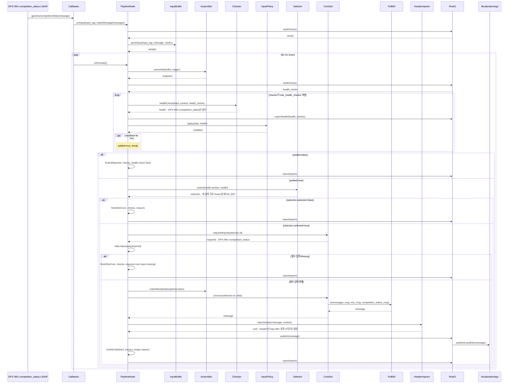

# Localization

`node_pipeline` 서비스 라이브러리를 사용하는 실행 패키지다. 50 Hz GPS·관성항법 EKF로 `/localization/ego`를 발행한다.

## 입출력

| 구분 | 토픽 | 타입 | 용도 |
| --- | --- | --- | --- |
| 구독 | `/sensors/gps/fix` | sensor_msgs/NavSatFix | WGS84→UTM 52N→map XY, 고도 변화 관측 |
| 구독 | `/sensors/imu/data` | sensor_msgs/Imu | 선가속도, 상태 예측 시각 |
| 구독 | `/vehicle/competition_status` | interfaces/CompetitionVehicleStatus | GT roll·pitch·yaw, velocity_x_mps, 3축 angular_velocity_*_radps |
| 구독 | `/velodyne_points/leveled` | sensor_msgs/PointCloud2 | 큐 적재만 수행, EKF 인자·Green 판정에 포함하지 않음 |
| 구독 | `/section_annotation` | interfaces/SectionAnnotation | section 선택 |
| 발행 | `/localization/ego` | nav_msgs/Odometry | map 위치·자세, base_link 3축 선속도·각속도, IMU 추정 시각 |

GPS·IMU·competition_status 세 입력이 모두 Green일 때만 `full_EKF`를 선택한다. UNKNOWN을 포함한 모든 정의된 section은 같은 Core에 매핑한다.
큐·조립·시각 검사·policy 반복·필수 입력 검사·발행은 라이브러리를 사용한다. ROS 구독·발행 큐 크기는 1이다.
주기 조립 기준은 최신 IMU다. 점군은 입력 큐에만 보관하며 조립 기준 시각이나 자세·위치의 대체 입력으로 사용하지 않는다.

## Core와 Pipeline 계약

`cores/full_ekf.hpp`에는 FullEkf 클래스의 계산과 지속 상태만 둔다.
`process(gps, imu, competition_status)`는 구독한 실제 메시지를 개별 인자로 받고 목표 발행 타입인 `nav_msgs::Odometry`의 pose·twist payload와 child_frame_id를 완성해 반환한다. 출력 header는 설정하지 않는다.
Core 내부에서는 입력 유효성 검사, fallback, 자동 reset, 발행 헤더 주입·발행을 하지 않는다.
공개 자세·3축 각속도는 competition_status의 GT를 사용하고 3축 선속도는 EKF로 추정한다. 누락 시 입력 대체를 하지 않는다.

Pipeline Validator가 frame·NaN/Inf·GPS fix·좌표 범위를 검사하고 공통 Checker가 stamp·stale·수신 timeout·세 입력 간 시차를 검사한다.
발견한 오류는 모두 Remove strategy로 해당 입력을 Missing으로 만든다. 제거한 입력은 반복 보정하지 않는다. 세 입력 중 하나라도 Green이 아니면 Core를 호출하지 않는다.
출력은 검사하지 않는다. HeaderInjector가 반환된 Odometry의 header에 frame_id=map, IMU 추정 시각만 주입한다. pose·twist payload와 child_frame_id는 수정하지 않는다.

## 임시 EKF

상태는 map 축 기준 `[x, y, 상대 고도, vx, vy, vz]`다. GT 자세로 회전한 IMU의 수평 가속도로 예측하며 GPS x·y·상대 고도와 GT 전방 속도 관측으로 보정한다.
상대 고도는 GPS 장착 높이를 자세로 보정한 첫 고도를 원점으로 사용한다. 수직은 등속 모델로 예측한다.
공개 3축 선속도는 상태 속도를 GT 자세로 base_link에 회전해 계산한다. `child_frame_id=base_link`다.
`pose.covariance`와 `twist.covariance`는 미제공이며 기본값 0 배열로 발행하고 구독자는 사용하지 않는다.
동일 stamp의 IMU 예측·GPS 및 GT 관측을 중복 융합하지 않는다. Core 상태와 공분산은 호출 사이에 유지한다.
공개 quaternion은 GT roll·pitch·yaw로 계산하며 UTM 격자 heading 오프셋을 적용한다. `position.z=0`이다.
GPS는 EPSG:32652에서 `(302595.0, 4124145.0)`을 차감한다. GPS 장착 높이 1.2 m를 GT 자세로 회전해 안테나 위치에서 차량 기준점으로 XYZ를 보정한다.
입력별 stale·수신 timeout은 `inputs`에서 지정한다.
임시 process/measurement noise와 heading 오프셋은 `config/localization.yaml`의 `ekf`에 지정한다.

## 파일 구성

| 파일 | 책임 |
| --- | --- |
| `src/localization_node.cpp` | ROS 연결, config·Core 구성 |
| `include/localization/components.hpp` | 메시지 Access·Validator, 세 입력 Green 선택, HeaderInjector |
| `include/localization/core_set.hpp` | 필수 입력 선언과 Core 인자 연결 |
| `include/localization/cores/full_ekf.hpp` | Core 하나의 알고리즘·상태 |
| `include/localization/projection.hpp` | WGS84→map 계산 |
| `config/localization.yaml` | 시간 한도, section 매핑, 임시 EKF 계수 |

launch는 이 패키지의 노드만 시작한다. 저장소 전체 bringup의 진입점은 상위 README의 `run.sh`다.

## 실행 시퀀스

