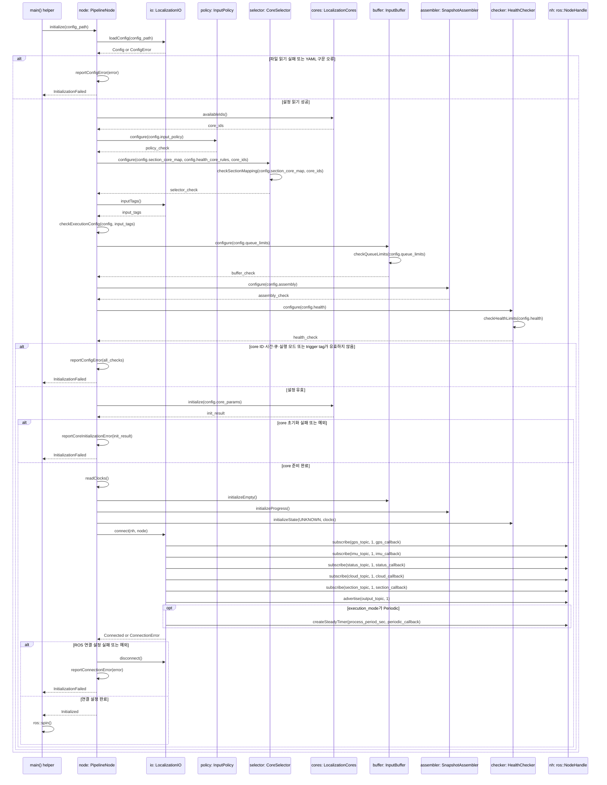
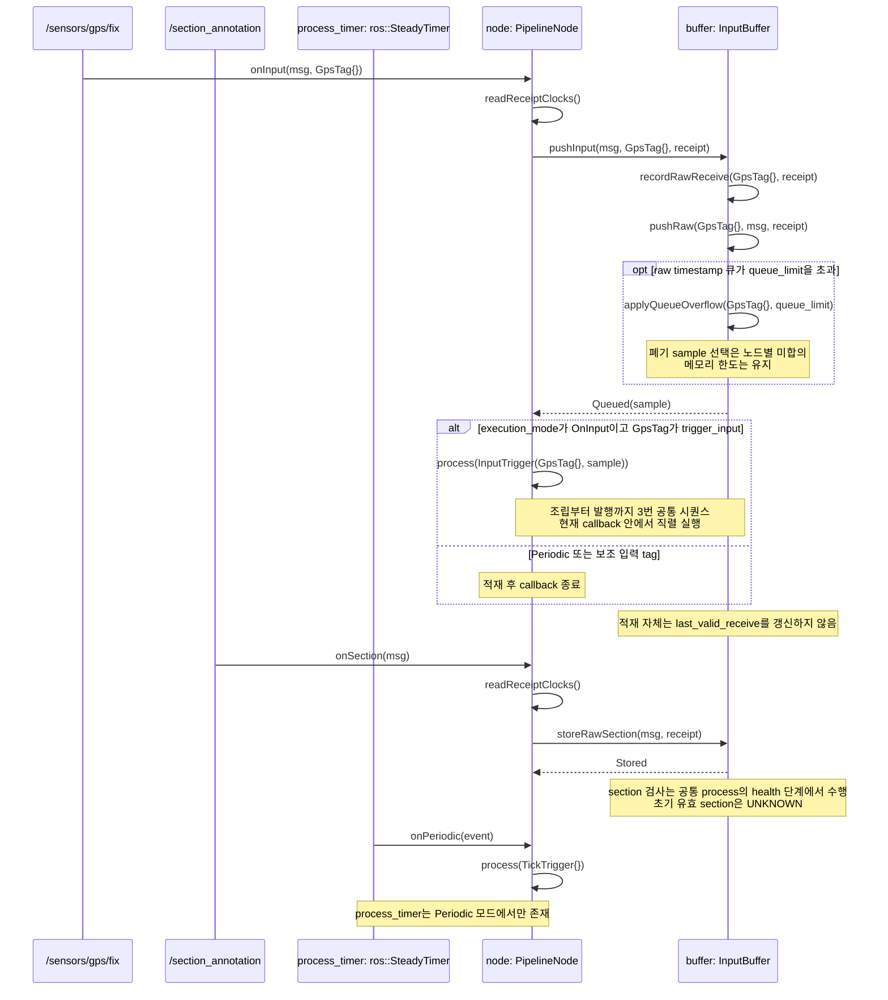
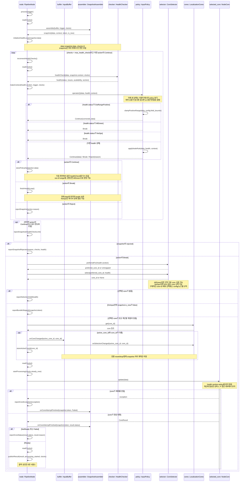
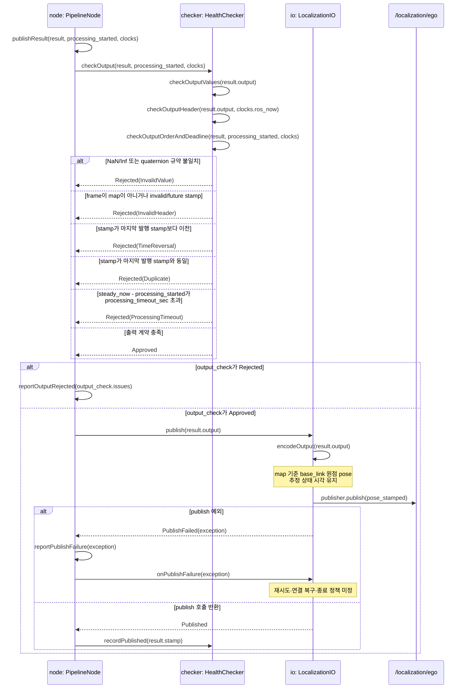

# 노드 템플릿 시퀀스 — proposed

`PipelineNode<IO, Assembler, Checker, Policy, Selector, CoreSet>`의 구현 전 초안이다. 객체·메서드는 아직 구현되지 않았다. 이 파일의 Mermaid 블록에서 뷰어를 생성하며 README와 실행 코드는 수정하지 않는다.

## 현재 합의와 책임

- `onInput()`은 먼저 raw 메시지와 수신 시각을 bounded queue에 push한다. Periodic 모드는 적재 후 종료하고, OnInput 모드는 지정된 trigger 입력의 callback에서만 공통 `process(trigger)`를 호출한다.
- Periodic은 timer tick에서 가능한 최신 기준으로 조립한다. OnInput은 지정 upstream의 방금 수신한 sample을 기준으로 조립한다. 보조 입력 callback은 적재만 한다. 스냅샷은 부분 입력을 허용한다.
- health는 Missing/Stale/ReceiveTimeout/Skew뿐 아니라 잘못된 stamp/frame, NaN/Inf, 범위 초과, GPS fix 등 입력 계약 검사도 포함한다.
- 조립 → healthCheck/policy 반복 → 마지막 health와 section으로 core 선택 → core.update(data) → 출력 승인·발행 순서다. healthCheck 횟수의 proposed 기본 한도는 max_health_checks=10이다.
- 초기 section은 UNKNOWN이며 enum → core 매핑은 config.yaml이다. 이는 기존 localization README의 초기 대기 규칙에 대한 최신 사용자 결정이다.
- 각 노드의 IO·Policy·core는 해당 노드의 Inputs/Output 타입에 전문화된다. `inputSpecs()`는 없다.
- core 인스턴스는 유지한다. EKF의 x, P, 상태 시각 등은 core 내부 상태다. 추정 알고리즘은 이 초안의 범위 밖이다.

공통 라이브러리는 루트 README의 서비스 패키지로 제공하는 안이다. `PipelineNode` 템플릿과 재사용되는 bounded queue·clock·상태 타입을 public header에 두고, 메시지별 검사·조립 규칙·Policy·core는 각 실행 패키지에 둔다. 실행 패키지 사이에 코드 의존성을 만들지 않는다. 실제 패키지 이름과 구현은 미정이다.

health 상태는 매번 현재 data를 healthCheck한 결과다. Policy가 next_state를 임의 지정하지 않는다. `OutRangePositive → clamp(data) → continue → healthCheck(data) → AllGreen → break`가 사용자가 제시한 전이 예다. `NoGps`도 policy가 break하면 terminal로 취급하며, 이후 CoreSelector가 GPS 없는 core를 고른다. AllGreen만 루프의 정상 종료 조건이 되는 것은 아니다.

Policy의 `operator()(data, health, context)`는 `Continue(corrected_data)` / `Break` / `Reject(reason)`를 반환한다. Continue는 data를 갱신하고 같은 healthCheck를 처음부터 다시 호출한다. Break는 현재 data와 방금 얻은 health를 그대로 넘긴다. Break 시 data를 변경하지 않는다. 변경한 data는 반드시 Continue로 재검사한다. Reject는 현재 snapshot의 core 실행·발행을 생략한다.

snapshot.context에는 원래 수신 metadata·최신 observation·raw section·정렬 기준을 둔다. 매 회차 같은 snapshot의 현재 data를 검사한다. 보정은 작업 data에 적용하고 raw 버퍼의 원본 객체는 변경하지 않는다. 루프 중 buffer를 다시 읽거나 새로 조립하지 않는다. 원래 stamp/수신 시각은 보존한다. policy 보정 이력은 진단 정보로 보관하지만 이미 해소된 원본 OutRangePositive를 현재 health에 다시 섞지 않는다. 마지막 검사 상태가 CoreSelector의 입력이다.

최대 10회 healthCheck한다. 10번째 검사에서 Break하면 수용하며, Continue라면 다음 검사를 실행하지 않고 snapshot reject한다. 횟수는 snapshot마다 초기화한다. CoreSelector가 section 기본 매핑과 마지막 health의 예외에 따라 호환 core를 선택한다. core는 health나 policy를 받지 않고 `update(data)`만 수행한다. 구체적인 다중 오류 우선순위·clamp 대상/한도·다른 health 처리표는 노드별로 정한다.

아래 실제 토픽과 출력 검사는 localization 예시다. control의 clamp/safe brake는 해당 노드의 Policy에 정의할 수 있다. localization의 invalid pose 입력을 임의 보정하는 규칙은 현재 계약에 없으며 추가하지 않았다. raw queue는 아직 채택되지 않은 수신 버퍼다. invalid raw를 그 버퍼에 담는 것이 유효 캐시나 core 입력으로 승인했다는 뜻은 아니다.

## helper 객체의 책임 — proposed

node가 아래 객체를 value member로 소유하고 직접 호출한다. 별도 worker·상속 계층·factory를 만들지 않는다. InputBuffer는 노드의 Inputs 타입에 맞춘 공통 버퍼이며 Assembler/Checker/Policy/Selector/CoreSet은 교체할 수 있다.

| 객체 | 소유하는 상태 | 책임 |
| --- | --- | --- |
| IO | subscriber·publisher·timer와 토픽 변환 설정 | ROS 연결, 메시지 변환, 실제 발행·전송 오류 처리 |
| InputBuffer | raw 큐·최신 observation·raw section·수신 시각/순번 | 입력 적재, bounded 저장, 읽기용 view 제공 |
| SnapshotAssembler | 조립 설정·처리한 묶음 token | trigger 기준 인접 시각 snapshot 조립, 신규 묶음 판정 |
| HealthChecker | 검사 설정·last_valid_receive·유효 section·이전 관측 health·마지막 발행 stamp | 매 회차 현재 data의 값/시간 검사, 출력 계약 승인, 원본 수신 health 기록 |
| Policy | 노드별 입력 대응 규칙 | 현재 health에 따라 data 보정 후 Continue, 현재 상태에서 Break, 또는 Reject |
| CoreSelector | section → core 설정·health별 core 선택 규칙 | 루프 종료 후 마지막 health와 section으로 core 선택 |
| CoreSet | core 객체와 각 core의 지속 계산 상태 | core 접근·선택 전환, 계산 상태 유지 |
| PipelineNode | 실행 모드·active core·처리 시작 시각 | callback과 공통 process의 호출 순서 |

## 실행 트리거 — proposed

| execution_mode / config | `process(trigger)` 호출자 | 조립 기준 |
| --- | --- | --- |
| `Periodic` | `onPeriodic()` | 가능한 최신 기준 sample + 인접 timestamp 입력 |
| `OnInput` + `trigger_input` | 해당 tag의 `onInput()` | 방금 수신한 trigger sample + 인접 timestamp 입력 |

README에 따라 LiDAR_Leveler는 `/velodyne_points`, Object_Detector는 `/velodyne_points/leveled`, Velocity_Planner는 `/local_path`, Speed_Filter는 `/control_cmd`, Section_Annotator와 동적 TF 발행은 `/localization/ego`가 callback trigger다. Localization의 50 Hz와 Traffic_Light의 목표 5 Hz는 Periodic에 대응한다. 나머지 미정 trigger는 임의로 정하지 않는다. 표는 해당 노드에 적용할 모드이며 아래 그림의 실제 토픽은 localization 대입 예시다.

단일 입력 노드는 trigger sample 하나로 snapshot을 만든다. 시간 결합 OnInput 노드는 새 묶음에 대해서만 계산·발행하며 보조 입력을 기다리는 barrier를 만들지 않는다. 같은 묶음의 신규 여부는 SnapshotAssembler의 token으로 표시한다. 동일 stamp·역행·실패한 묶음의 token 소비 규칙은 별도 미정이다. Periodic은 유효한 최신 입력을 주기적으로 사용할 수 있고, 결과 중복 발행 허용 여부는 노드 출력 계약을 따른다.

OnInput에서는 trigger upstream이 끊기면 process 호출도 없다. trigger 무수신 중 timeout 감시 또는 safe 출력이 필요한 노드는 감시 timer 계약을 별도로 정해야 한다. 이번 안에서는 없는 새 입력을 만들어 callback 계산·발행을 실행하지 않는다.

## 1. 초기화 — proposed

| 객체 / 구현 위치 | 메서드·인자·결과 | 책임·상태·제한 |
| --- | --- | --- |
| main / 미구현 | `initialize()`, `ros::spin()` | 단일 callback queue에서 직렬 실행. 초기화 실패 후 프로세스 처리 방식 미정. |
| PipelineNode / 공통 미구현 | `initialize()`, `checkExecutionConfig()` | 실행 모드·trigger tag·Periodic 주기와 양의 정수 max_health_checks 검사. trigger tag는 IO가 등록한 tag여야 함. 진단 report helper는 동기 ROS 로그이며 공개 토픽을 추가하지 않음. |
| IO / 노드 전용 미구현 | `loadConfig()`, `inputTags()`, `connect()`, `disconnect()` | 설정 읽기와 ROS 연결만 소유. 읽기 실패/부분 연결 실패를 반환하며 생성한 연결만 정리하는 proposed 방어안. ROS 발행·구독 큐 깊이 1. |
| InputBuffer / 공통 미구현 | `configure()`, `checkQueueLimits()`, `initializeEmpty()` | timestamp raw 큐 한도는 양수. ROS 구독 큐와 별도. |
| SnapshotAssembler / 노드 전용 미구현 | `configure()`, `initializeProgress()` | 조립 규칙과 묶음 진행 상태 초기화. 기준 입력·tie·token 소비 상세는 미정. |
| HealthChecker / 노드 전용 미구현 | `configure()`, `checkHealthLimits()`, `initializeState()` | 시간·값 검사 한도는 유한값. 시작 steady 시각과 UNKNOWN 유효 section 초기화. 시간값의 0 허용 여부·필드별 허용 범위는 미정. |
| InputPolicy / 노드 전용 미구현 | `configure()` | 보정·Continue/Break/Reject 규칙의 설정. |
| CoreSelector / 노드 전용 미구현 | `configure()`, `checkSectionMapping()` | enum 매핑과 health 예외의 실제 core ID 검사. |
| CoreSet / 노드 전용 미구현 | `availableIds()`, `initialize()` | 지속 core 객체 초기화. |
| ros::NodeHandle / ROS 1 Noetic | `subscribe()`, `advertise()`, `createSteadyTimer()` | Periodic 모드만 timer 생성. 외부 ROS 전송 내부 복구는 검토 범위 밖. |

## 2. 입력 적재와 두 실행 트리거 — proposed

| 객체 / 구현 위치 | 메서드·인자·결과 | 책임·상태·제한 |
| --- | --- | --- |
| 입력 토픽 / 루트 README | `onInput(msg, Tag{})` | 다른 입력도 노드 전용 tag로 동일 경로 사용. 토픽에 반환 화살표 없음. |
| PipelineNode / 미구현 | `onInput()`, `onSection()`, `onPeriodic()`, `readReceiptClocks()` | buffer 적재 후 지정 trigger 또는 tick에서 process 호출. 보조 입력은 적재만. |
| InputBuffer / 미구현 | `pushInput()`, `recordRawReceive()`, `pushRaw()`, `applyQueueOverflow()` | raw·receipt·순번 보관. Queued의 sample은 처리 종료까지 수명 보장. 최신 raw 수신과 유효 수신을 혼동하지 않음. queue 초과 폐기 대상은 미정. |
| InputBuffer / 미구현 | `storeRawSection()` | 최신 raw section 하나만 보관. 유효 section 판단은 HealthChecker 소유. |
| process_timer / IO 소유 | `onPeriodic() → process(TickTrigger{})` | Periodic에서만 존재. OnInput과 공통 process를 직렬 실행. |

## 3. 공통 process — healthCheck를 반복한 뒤 core 선택 — proposed

| 객체 / 구현 위치 | 메서드·인자·결과 | 책임·상태·제한 |
| --- | --- | --- |
| PipelineNode / 미구현 | `process()`, `initializeHealthLoop()`, `incrementHealthChecks()`, `storePolicyData()`, `finishHealthLoop()`, `rejectSnapshot()` | 두 trigger의 공통 순서. data·checks·action은 process 지역 상태. 최초 action=Continue. Continue는 현재 data를 다음 검사의 입력으로 사용. Break는 data/health를 변경하지 않고 루프 종료. 10번째 Break 수용, 10번째 Continue는 한도 거부. |
| SnapshotAssembler / 미구현 | `assemble()`, `onCoreAttemptFinished()` | 루프 전에 한 번 조립. OnInput은 새 묶음만 실행. token 소비·재시도 미정. |
| HealthChecker / 미구현 | `healthCheck(data,context,clocks) → Health` | 최초/보정 후 모두 같은 검사 메서드. 현재 issues로 status 산출. 이미 해결한 원본 문제는 진단 이력에만 보관하며 현재 status를 고정하지 않음. |
| InputPolicy / 미구현 | `operator()(data,health,context) → Action`, `clampPositiveRange()`, `applyNodeRule()` | Continue/Break/Reject를 결정. next_state/Ready 같은 처리 state를 설정하지 않음. 상태 전이는 보정 data를 다시 검사한 결과로 드러난다. clamp는 노드가 정한 field_bounds에 적용하며 구체 필드·한도는 미정. |
| CoreSelector / 미구현 | `preferredFor(section)`, `select(preferred,health)` | 구역 기본 선택과 마지막 health의 예외 선택. AllGreen만 허용하지 않고 NoGps에 호환되는 core도 선택 가능. 실제 core ID/선택표는 미정. |
| InputBuffer / 미구현 | `onCoreChanged()` | 전환 raw 큐 처리 hook. snapshot 참조 수명은 종료까지 보장. 현재 snapshot의 실행/보류·drop 범위는 미정. |
| CoreSet / 미구현 | `get()`, `onSelectionChanged()` | core 객체와 지속 계산 상태 관리. |
| NodeCore / 미구현 | `update(Inputs const&) → CoreResult` | health 검사·policy 적용·core 선택은 하지 않음. CoreSelector가 선택한 호환 data를 받아 계산만 수행. core 내부 알고리즘과 준비/실패 판정은 해당 core의 책임. |

## 4. 스냅샷 조립과 health 내부 — proposed

```mermaid
sequenceDiagram
    participant N as node: PipelineNode
    participant B as buffer: InputBuffer
    participant A as assembler: SnapshotAssembler
    participant H as checker: HealthChecker

    N->>A: assemble(buffer, trigger, clocks)
    A->>B: readView()
    B-->>A: raw_view(queues, latest_observations, raw_section)
    alt trigger가 TickTrigger
        A->>A: chooseLatestReference(queues)
        Note over A: 기준 입력·최신 기준 선택은 노드 전용 규칙
    else trigger가 InputTrigger(tag, sample)
        A->>A: setReferenceSample(trigger.tag, trigger.sample)
        Note over A: 방금 받은 trigger sample을 기준으로 사용<br/>다른 큐의 최신 sample로 기준을 바꾸지 않음
    end
    loop 각 노드 전용 입력 tag
        alt tag가 기준 입력 tag
            A->>A: attachRawSample(tag, reference_sample)
        else 기준 stamp를 정렬에 사용할 수 없음
            A->>A: attachUnalignedRaw(tag, latest_received)
        else 정렬 가능한 기준과 보조 입력 tag
            A->>A: findNearestRawSample(tag, reference_stamp)
        alt 인접 후보가 있음
            A->>A: attachRawSample(tag, sample)
        else stamp를 정렬에 쓸 수 없음
            A->>A: attachUnalignedRaw(tag, latest_received)
            Note over A: 원본 유지·stamp를 새로 만들지 않음<br/>사용 가능 여부는 이후 health 판정
        else 입력 후보가 없음
            A->>A: attachMissing(tag)
        end
        end
        A->>A: attachLatestObservation(tag)
    end
    A->>A: attachRawSection()
    A->>A: makeBundleToken(selected_sample_ids)
    A->>A: checkBundleNovelty(token)
    A->>A: makeSnapshot()
    A-->>N: Snapshot

    Note over N,H: 아래 동일 healthCheck를 3번 loop의 매 회차 호출
    N->>H: healthCheck(data, snapshot.context, clocks)
    H->>H: clearCurrentIssues()
    H->>H: inspectRawObservations(snapshot.context)
    Note over H: raw 수신 이력과 현재 data의 판정은 구분<br/>보정 전 문제를 현재 data에 다시 섞지 않음
    loop 각 노드 전용 입력 tag
        alt 현재 data에 sample이 없음
            H->>H: addInputIssue(tag, Missing)
        else sample이 있음
            H->>H: checkInputHeader(sample, tag, clocks)
            H->>H: checkInputValues(sample, tag)
            alt frame 불일치·invalid/future stamp·NaN/Inf·범위 초과·GPS NO_FIX
                H->>H: addInputIssues(tag, all_issues)
                H->>H: markUnavailable(tag)
            else 현재 입력 계약 검사 통과
                H->>H: markUsable(tag)
                opt 유효하게 채택한 receipt가 기존 기록보다 최신이거나 첫 유효 수신
                    H->>H: recordValidReceive(tag, sample.receipt_steady)
                end
            end
            opt sample에 유효한 Header stamp가 있음
                alt ros_now - stamp가 stale_after_sec 초과
                    H->>H: addInputIssue(tag, Stale)
                end
            end
            opt 정렬 불가 또는 시각 차이가 max_sensor_skew_sec 초과
                H->>H: addInputIssue(tag, UnalignedOrSkew)
            end
        end
        H->>H: inspectReceiveTimeout(tag, clocks.steady_now)
        alt 유효 수신이 없고 시작 후 receive_timeout_sec 초과
            H->>H: addInputIssue(tag, MissingAndReceiveTimeout)
        else 마지막 유효 수신 후 receive_timeout_sec 초과
            H->>H: addInputIssue(tag, ReceiveTimeout)
        end
    end
    H->>H: checkSectionHeaderAndEnum(snapshot.context.raw_section, clocks)
    alt section 원본 입력이 아직 없음
        H->>H: useSection(UNKNOWN)
    else undefined enum 또는 invalid frame/stamp
        H->>H: addSectionIssues(section_issues)
        H->>H: keepLastValidSection()
    else 유효한 section
        H->>H: updateValidSection(snapshot.context.raw_section)
    end
    H->>H: classifyCurrentHealth(current_issues, availability)
    H-->>N: Health(status, issues, availability, section)

```

| 객체 / 구현 위치 | 메서드·인자·결과 | 책임·상태·제한 |
| --- | --- | --- |
| InputBuffer / 미구현 | `readView()` | 원본 큐·최신 observation·raw section에 대한 읽기 view. 처리 종료까지 참조 수명 보장. |
| SnapshotAssembler / 미구현 | `chooseLatestReference()`, `setReferenceSample()`, `findNearestRawSample()`, `attachRawSample()` | Periodic은 최신 기준, OnInput은 방금 받은 sample 기준. 단일 입력은 sample 하나가 data. 값 검사로 후보를 미리 거부하지 않음. |
| SnapshotAssembler / 미구현 | `attachUnalignedRaw()`, `attachMissing()`, `attachLatestObservation()`, `makeBundleToken()`, `checkBundleNovelty()` | 부분 입력과 정렬 불가 원본도 보존. stamp를 새로 만들지 않음. token·tie·역행 상세 미정. |
| HealthChecker / 미구현 | `clearCurrentIssues()`, `checkInputHeader()`, `checkInputValues()`, `classifyCurrentHealth()` | 매 회차 현재 data에서 health를 다시 산출. OutRangePositive/AllGreen/NoGps는 사용자 예시의 상태. 다중 오류의 상태 산출·우선순위는 노드별 미정. |
| HealthChecker / 미구현 | `inspectRawObservations()`, `recordValidReceive()`, `inspectReceiveTimeout()` | 원본/latest 수신 상태와 선택 data의 검사 결과를 구분. valid receipt는 채택된 유효 입력의 원래 steady 수신 시각으로 기록하고 보정 실행 시각으로 최신성을 가장하지 않음. 원본 invalid 진단은 보정 이력에 보존. |
| HealthChecker / 미구현 | `checkSectionHeaderAndEnum()`, `updateValidSection()` | UNKNOWN=0·ego 시각 계약. invalid section은 이전 유효 section 유지. |
| 시간 검사 / HealthChecker | Header·receipt·skew 검사 | stale/future는 ROS 시간·원래 Header, 수신 timeout은 steady 시간·시작/마지막 유효 receipt 기준. Header 없는 입력은 stamp 나이 검사 생략. |

## 5. 출력 승인과 실제 발행 — localization 예시 / proposed

| 객체 / 구현 위치 | 메서드·인자·결과 | 책임·상태·제한 |
| --- | --- | --- |
| PipelineNode / 미구현 | `publishResult()` | checker 승인 후 IO publish 호출. 실패/거부는 동기 로그로 보고. |
| HealthChecker / 미구현 | `checkOutput()`, `recordPublished()` | 노드별 출력 계약 검사와 마지막 성공 발행 stamp 보관. 일반 Output에 pose/Header를 강제하지 않음. core 결과를 승인하며 별도 출력 보정 policy는 추가하지 않음. |
| IO / 미구현 | `publish()`, `encodeOutput()`, `onPublishFailure()` | 승인 결과를 ROS 메시지로 표현·발행. 검사·clamp·fallback을 숨겨 넣지 않음. 공개 frame/stamp/단위 유지. |
| 실제 출력 토픽 / 루트 README | `ros::Publisher::publish(PoseStamped)` | `/localization/ego`가 실제 공개 종단. publish 반환은 하류 수신 확인이 아님. 유효한 새 위치 결과당 최대 한 번 발행. |
| 처리 기한 / config | `steady_now - processing_started` | core 반환 후 승인 기한이며 강제 중단 기능 아님. 반환하지 않는 core 감시/respawn 미정. |

## 구현 전 남은 정책

1. 조립 기준 입력·최신 기준 선택·인접 후보 tie·중복/역행·raw queue overflow 대상·ROS 시간 reset.
2. 입력 이상별 health 상태 산출·policy Continue/Break/Reject와 보정/폐기/대체표, 구역별 기본 core와 health별 예외 선택표. root/localization 계약 밖의 위치 입력 보정은 미합의.
3. core 전환 reset/상태 이관/drop과 현재 snapshot의 이후 처리, 동일 snapshot 재사용·실패 token 재시도.
4. OnInput trigger 무수신 감시와 그때의 출력 계약·section 만료·검사 범위/허용차·로그 반복 억제·초기화/발행 실패 후 동작.

이 파일은 순서와 컴포넌트 경계의 proposed 설계다. 미정 hook의 내부 분기와 값을 합의하기 전에는 실행 코드와 완전 정합이라고 주장하지 않는다.
