# node_pipeline

ROS Noetic·C++14 공통 실행기다. 노드는 `node.yaml`, Core는 `registrations/*.yaml`로 연결한다. 모든 실행 파일은 같은 `src/main.cpp`를 사용한다. 빌드는 타입 연결만 생성하며 객체 생성·설정·Bank 주입·실행은 공통 구현이 담당한다.

## 선언과 확장점

| 파일 | 작성 범위 |
| --- | --- |
| `<package>/node.yaml` | 리드가 입력 이름·토픽·Stage 순서·후보 Core·선택 매핑·최종 발행을 선언 |
| `include/<package>/cores/*.hpp` | native `process()`와 계산 상태 |
| `include/<package>/parameters/*.hpp` | 해당 Core 설정·선언된 정적 자산을 생성자 인자로 변환 |
| `include/<package>/validators/*.hpp` | 도메인 고유 검사 |
| `include/<package>/policies/*.hpp` | payload 보정·제거, `apply()`의 bool 반환 |
| `registrations/*.yaml` | Core별 입력·출력·Validator·Policy·로더·Bank·허용 issue 연결 |

공식 SDK는 `node_pipeline/sdk.hpp`다. `Parameters`는 읽기 전용 Core 설정과 선언된 `asset(name)` 경로만 제공한다. `InputView`는 native payload의 `get<T>(name)`·`modify<T>(name, fn)`·`remove(name)`·`present(name)`만 제공한다. Validator는 `operator()(const InputView&, ProfileHealth&)`, Policy는 `apply(InputView&, const ProfileHealth&) → bool`이다. 계산 Core에는 이 래퍼를 전달하지 않는다.

실행 모드·큐·검사 상한·공통 한도·선택·헤더·ROS 입출력은 내부 구현이다. 외부에서 실행 함수·Assembler·Selector·HeaderInjector·IO·Stage callback을 주입하지 않는다. 생성 C++과 `detail/`은 확장점이 아니다. 기존 직접 생성 API는 path_planner의 명시적 legacy target에서만 사용한다.

```yaml
# localization/node.yaml
name: localization
execution: {mode: periodic, frequency_hz: 50}
inputs:
  gps: {type: sensor_msgs/NavSatFix, topic: /sensors/gps/fix}
  imu: {type: sensor_msgs/Imu, topic: /sensors/imu/data}
  competition: {type: interfaces/CompetitionVehicleStatus, topic: /vehicle/competition_status}
  lidar: {type: sensor_msgs/PointCloud2, topic: /velodyne_points/leveled}
section_topic: /section_annotation
banks:
  state_bank: {type: localization::StateBank, header: localization/cores/state_bank.hpp}
stages:
  estimate:
    cores: [full_ekf.hpp, tunnel_wall.hpp]
    # 구역 매핑 일부
    section_core_map: {"0": full_ekf.hpp, "15": tunnel_wall.hpp}
    health_core_map: []
output:
  source: estimate.ego
  topic: /localization/ego
  header: {stamp_from: imu, frame_id: map}
```

```yaml
# localization/registrations/full_ekf.yaml
name: full_ekf.hpp
type: localization::FullEkf
stage: estimate
inputs: [gps, imu, competition]
outputs: [{name: ego, type: nav_msgs/Odometry}]
validator: {header: localization/validators/full_ekf.hpp, type: localization::validators::FullEkf}
policy: {header: localization/policies/remove_invalid.hpp, type: localization::policies::RemoveInvalid}
parameter_loader: {header: localization/parameters/full_ekf.hpp, type: localization::parameters::FullEkf}
parameter_namespace: ekf
bank: state_bank
allowed_issues: {}
```

`inputs`의 순서는 native 인자 순서이며 **모두 필수**다. `required_inputs`는 스키마에서 거부한다. 출력 순서는 반환값 순서다. 단일값·`std::pair`·`std::tuple`을 지원한다. 수정·패스스루 출력은 `{name: ..., type: ..., time_from: input_name}`으로 원본 stamp·수신 시각만 상속한다. 새 계산값에는 시간 메타데이터를 만들지 않는다.

YAML에는 C++ 표현식·함수 본문·임의 factory를 받지 않는다. Core 추가·제거·매핑 변경 후 재빌드하며 Pipeline C++을 수정하지 않는다. 등록 diff와 범위는 [CORE_REGISTRATION.md](CORE_REGISTRATION.md)를 따른다. [templates/](templates/)는 선언·Core·로더 예제이며 노드 실행 코드를 복사하는 접점을 제공하지 않는다.

## 고정 실행 계약

1. 직렬 입력 callback은 원본 메시지를 큐에 보관하고 sample ID·steady 수신 시각을 기록한다. 공유 소유권은 원본 메시지 수명을 유지하며 clone하지 않는다. Policy 수정 때만 payload를 복사한다. ROS 구독 큐는 1, 조립 큐 용량은 공통 설정이다.
2. Assembler는 항상 스냅샷을 반환한다. periodic은 전체 큐의 최대 stamp를 기준으로 가까운 입력을 선택하고, 동률이면 큰 sample ID를 선택한다. on_input은 방금 수신한 ID로 해당 입력을 고정한다. 시각 정렬을 노드나 Core에서 구현하지 않는다.
3. 중복 실행 여부는 마지막 계산 시도 token으로 판정한다. on_input·require_new_snapshot은 같은 token을 생략하며 periodic 기본값은 같은 입력도 실행한다.
4. 실행마다 검사 시각을 한 번 읽는다. 모든 Stage·재검사가 같은 스냅샷 문맥·검사 시각을 사용한다. Stage는 section 초기 선택을 한 번 수행한다.
5. 선택된 Core의 native 입력 구조·공통 검사·Validator로 health를 만든다. Validator는 읽기 전용 입력에서 도메인 issue를 추가하며 공통 issue를 제거하지 못한다. 타입·개수 검사는 빈 슬롯도 통과할 수 있으며 Missing은 별도 존재 검사다. 공통 검사층은 Missing·NaN·Inf·수치 범위·frame·stamp·receive_timeout·stale·skew를 검사한다. 시간 정보가 없는 계산값에는 해당 시간 검사를 적용하지 않는다.
6. 모든 선언 입력이 존재하고 허용 issue만 남으면 검사 루프를 끝낸다. Missing·유효하지 않은 값·미래 stamp는 면제하지 않는다. 그 외에는 health 매핑으로 Core를 덮어쓰고 **선택된 Core의 Policy를 적용한 뒤** 다음 회차에서 재검사한다. Core가 바뀌어도 Policy를 건너뛰지 않는다. 다음 회차의 Validator는 변경된 Core의 것이다. Policy false만으로 검사 완료를 판단하지 않는다.
7. health 매핑은 이름으로 input을 식별한다. `when`은 AND이며 가장 높은 priority의 일치 규칙을 적용한다. 불일치하면 현재 Core를 유지한다. 빈 조건·범위 밖 input·최고 priority 동률은 설정 오류다. Stage 검사 상한 기본값은 10이며 마지막 회차에서 완료를 확인하면 수용하고, 아니면 후속 계산·발행을 생략한다.
8. 첫 Core 호출 직전에 Pipeline이 token을 직접 기록한다. Core 반환 native 값으로 다음 Stage의 입력을 **교체**한다. 원본 슬롯을 자동 누적·병합하지 않는다. 후속 입력은 앞 Core가 함께 반환한다. `/section_annotation`은 조립·Core 주입 없이 선택에만 사용한다.
9. Core·Bank 객체는 지속 보유하며 선택이 바뀌어도 reset·재생성하지 않는다. 다른 계산 Core를 소유·참조·호출하지 않는다. 같은 패키지 Bank만 참조할 수 있다.
10. 공통 인젝터는 `output.header`의 `stamp_from`·`frame_id`를 가장 바깥 `header`에만 주입한다. 바깥 `header`가 없으면 주입하지 않는다. 중첩 헤더는 Core의 반환 payload를 유지한다. 출력 검사 없이 한 번 발행하며 localization stamp는 조립된 IMU 입력에서 가져온다.

`on_input`은 지정 입력 callback, `periodic`은 steady timer, `latched`는 시작 시 한 번 실행하고 latched publisher를 유지한다. 정적 TF는 공통 `static_transforms` 선언으로 전체 bundle을 시작 시 한 번 발행한다. 동적 TF와 별도 시작 경로를 노드 소스에서 작성하지 않는다. 실행 중 예외는 재시도·fallback하지 않고 실행 파일을 종료한다.

## 필수 빌드 검사

- YAML: 중복·알 수 없는 항목·등록 이름·입출력 연결·앞뒤 후보 호환성·선택 매핑·time_from 검사.
- C++: `process()`의 인자·반환 타입·개수·순서 검사.
- Clang AST: 자체 확장 소스의 Pipeline 내부 접근·다른 계산 Core 결합·허용되지 않은 ROS 통신·별도 main 검사. 같은 패키지 Bank와 공식 `/visualizer/*` 발행을 허용한다.

외부 계산 라이브러리 내부까지 검사하지 않는다. path_planner는 진행 계산 결정 후 별도 전환하며 이번 전환은 기존 알고리즘을 바꾸지 않는다.

## 구현 전 합의 실행 시퀀스

구현 전에 합의한 다이어그램 원문이다. 이후 확정한 YAML 선언·필수 입력·latched·최외곽 헤더 계약은 위의 고정 실행 계약을 따른다.

```mermaid
sequenceDiagram
    participant M as main
    participant U as 입력 토픽
    participant SE as /section_annotation
    participant T as ros::SteadyTimer
    participant CB as callbacks: RosCallbacks
    participant N as node: PipelineNode
    participant B as InputBuffer
    participant A as SnapshotAssembler
    participant H as checker: HealthChecker
    participant V as validator: profile.validator
    participant P as 선택된 Core의 InputPolicy
    participant S as selector: CoreSelector
    participant C as cores: CoreSet
    participant D as dispatch: processCore
    participant K as core: cores.primary / cores.auxiliary
    participant MB as RosHeaderInjector
    participant IO as RosIO
    participant O as 출력 토픽

    M->>M: loadRosConfig(nh, params, topics, inputs, empty cores, selector, policy)
    M->>M: loadStageConfig(stage_params, input_registry, core_profiles, selector)
    M->>M: makeStage(core_profiles, selector, dispatch)
    alt config 형식·타입·이름·한도 오류 또는 Core별 입출력·Validator·Policy·필수 입력·허용 issue 연결 오류
        M-->>M: throw std::invalid_argument
    else 정상 설정
        M-->>M: settings
        M->>C: CoreSet{core objects}
        C-->>M: cores
        M->>N: PipelineNode(execution, buffer, assembler, stages, cores, header_injector, io)
        alt stages 비어 있음 또는 helper 누락 또는 max_health_checks=0 또는 실행 모드 오류 또는 OnInput trigger 미등록
            N-->>M: throw std::invalid_argument
        else 유효 실행 설정
            N-->>M: node
        end
    end
    loop ROS callback 직렬 실행
        alt section 수신
            SE->>CB: onSection(message)
            CB->>N: onSection(Section)
            N->>B: storeRawSection(section)
        else input 수신
            U->>CB: onInput(message)
            CB->>CB: retainMessage(message)
            CB-->>CB: retained_message
            CB->>N: onInput(input_tag, retained_message)
            N->>IO: readClocks()
            IO-->>N: receive_clocks
            N->>B: pushInput(input_tag, retained_message, receive_clocks)
            B-->>N: sample
            opt OnInput이며 지정 input
                N->>N: process(trigger)
            end
        else timer tick
            T->>CB: onPeriodic(event)
            CB->>N: onPeriodic()
            N->>N: process(trigger)
        end
        opt process 호출됨
            N->>A: assemble(buffer, trigger)
            A-->>N: assembled
            N->>N: snapshot.data.update(assembled.data)
            alt OnInput 또는 require_new_snapshot이며 snapshot.is_new=false
                N->>N: finish(Skipped, 0, bundle already attempted)
                N->>IO: report(report)
            else 새 스냅샷 또는 Periodic
                N->>IO: readClocks()
                IO-->>N: health_clocks
                loop stage_index=0부터 n-1까지
                    Note over N: checks=0, settled=false
                    N->>S: selectSection(snapshot.context.section, health_clocks)
                    alt section 미수신 또는 frame!=map 또는 stamp_ns<=0 또는 stamp_ns>health_clocks.ros_ns
                        Note over S: section=UNKNOWN(0)
                    else 유효 section
                        Note over S: section=context.section.state
                    end
                    S-->>N: selection
                    break selection.selected=false
                        N->>N: finish(NoCore, checks, no compatible core)
                        N->>IO: report(report)
                    end
                    loop checks가 max_health_checks 미만이고 settled=false
                        Note over N: checks += 1
                        N->>N: stage.coreProfile(selection.id)
                        N-->>N: profile
                        N->>N: profile.ContractCheck(snapshot.data, snapshot.context, health_clocks)
                        alt Core 선언 입력 슬롯 부족 또는 존재 payload 타입 불일치
                            N-->>N: throw std::invalid_argument
                        else 입력 계약 일치
                            N->>H: healthCheck(typed data, snapshot.context, health_clocks)
                        end
                        loop 현재 입력 슬롯
                            alt 입력값 Missing
                                Note over H: issues += Missing
                                opt 최초 스테이지의 구독 입력이며 check_receive_timeout=true
                                    Note over H: 노드 시작 시각 기준 ReceiveTimeout 검사
                                end
                            else 입력값 존재
                                opt frame 검사 대상이며 Access::frame(slot.message()) != input_limits_[tag].frame
                                    Note over H: issues += FrameMismatch
                                end
                                loop 입력 계약에 선언된 검사 대상 수치 필드 value
                                    H->>H: checkNumber(value, input_limits_[tag], issues)
                                    alt std::isnan(value)
                                        Note over H: issues += NaN
                                    else std::isinf(value)
                                        Note over H: issues += Inf
                                    else value > input_limits_[tag].upper
                                        Note over H: issues += OutRangePositive
                                    else value < input_limits_[tag].lower
                                        Note over H: issues += OutRangeNegative
                                    else 유한하고 범위 내
                                        Note over H: 수치 issue 없음
                                    end
                                end
                                opt check_stamp=true이고 stamp_ns 있음
                                    Note over H: InvalidStamp·FutureStamp·Stale 검사
                                end
                                opt check_receive_timeout=true이고 receipt_steady_ns 있음
                                    Note over H: ReceiveTimeout 검사
                                end
                                opt 양쪽 check_skew=true이고 stamp_ns가 있는 입력 쌍
                                    Note over H: Skew 검사
                                end
                                H->>V: operator()(slot.message(), input_limits_[tag], issues)
                            end
                        end
                        H-->>N: health
                        N->>IO: reportHealth(health, checks)
                        N->>N: snapshot.data.hasInputs(profile.required_inputs)
                        N-->>N: required_present
                        N->>N: stage.acceptsIssues(selection.id, health)
                        N-->>N: issues_allowed
                        alt required_present=true이고 issues_allowed=true
                            Note over N: settled=true, break health check loop
                        else 수용 조건 불충족
                            N->>S: overrideHealth(selection, typed health)
                            alt when 비어 있음 또는 condition.input이 health.inputs 범위 밖 또는 일치한 최고 priority 동률
                                S-->>N: throw std::invalid_argument / std::out_of_range
                            else 일치 규칙 있음
                                Note over S: 최고 priority 규칙의 Core로 덮어씀
                                S-->>N: next_selection
                            else 일치 규칙 없음
                                Note over S: 현재 selection 유지
                                S-->>N: next_selection
                            end
                            Note over N: selection=next_selection
                            N->>N: stage.coreProfile(selection.id)
                            N-->>N: profile
                            N->>P: profile.policy.apply(typed data, health)
                            P-->>N: modified
                            Note over N: 다음 검사 회차
                        end
                    end
                    break settled=false
                        N->>N: finish(Rejected, checks, health check limit)
                        N->>IO: report(report)
                    end
                    opt stage_index=0
                        N->>A: markAttempted(snapshot.token)
                    end
                    N->>D: stage.process(cores, selection.id, snapshot.data, result)
                    alt case CoreId::Primary
                        D->>D: data.hasInputs(required_primary)
                        D-->>D: present
                        break present=false
                            D-->>N: false
                            N->>N: finish(NoCore, checks, required core input missing)
                            N->>IO: report(report)
                        end
                        D->>C: cores.primary
                        C-->>D: core
                        D->>K: core.process(data.message〈Message〉(0))
                        K-->>D: value
                        D->>D: wrapResult(value, origins)
                        D-->>D: result
                    else case CoreId::Auxiliary
                        D->>D: data.hasInputs(required_auxiliary)
                        D-->>D: present
                        break present=false
                            D-->>N: false
                            N->>N: finish(NoCore, checks, required core input missing)
                            N->>IO: report(report)
                        end
                        D->>C: cores.auxiliary
                        C-->>D: core
                        D->>K: core.process(data.message〈Message〉(1))
                        K-->>D: value
                        D->>D: wrapResult(value, origins)
                        D-->>D: result
                    else 미등록 Core ID
                        D-->>N: throw std::invalid_argument
                    end
                    D-->>N: true
                    N->>N: replaceInputs(snapshot, result)
                    alt 반환 슬롯 원본 대응 개수·인덱스 오류
                        N-->>N: throw std::invalid_argument / std::out_of_range
                    else 원본 대응 유효
                        Note over N: snapshot.data.inputs 교체
                    end
                end
                N->>N: snapshot.data.message〈IO::MessageType〉(0)
                alt 최종 입력 슬롯 Missing 또는 발행 타입 불일치
                    N-->>N: throw std::invalid_argument
                else 발행 타입 일치
                    N-->>N: message
                end
                N->>MB: injectHeader(message, snapshot.context)
                N->>IO: publish(message)
                IO->>O: publisher.publish(message)
                N->>N: finish(Published, checks, empty reason)
                N->>IO: report(report)
            end
        end
    end
```



## 기존 라이브러리 상세 실행 시퀀스

기존 라이브러리의 상세 다이어그램 원문이다.

```mermaid
sequenceDiagram
    participant M as main
    participant U as 입력 토픽
    participant SE as /section_annotation
    participant T as ros::SteadyTimer
    participant CB as callbacks: RosCallbacks
    participant N as node: PipelineNode
    participant B as InputBuffer
    participant A as SnapshotAssembler
    participant H as checker: HealthChecker
    participant P as policy: InputPolicy
    participant S as selector: CoreSelector
    participant C as cores: CoreSet
    participant D as dispatch: processCore
    participant K as core: cores.primary / cores.auxiliary
    participant MB as RosHeaderInjector
    participant IO as RosIO
    participant O as 출력 토픽

    M->>M: loadRosConfig(nh, params, topics, inputs, empty cores, selector, policy)
    M->>M: loadStageConfig(stage_params, inputs, cores, selector, policy)
    M->>M: makeStage(checker, policy, selector, dispatch)
    alt config 형식·타입·이름·한도 오류
        M-->>M: throw std::invalid_argument
    else 정상 설정
        M-->>M: settings
        M->>C: CoreSet{core objects}
        C-->>M: cores
        M->>N: PipelineNode(execution, buffer, assembler, stages, cores, header_injector, io)
        alt stages 비어 있음 또는 helper 누락 또는 max_health_checks=0 또는 실행 모드 오류 또는 OnInput trigger 미등록
            N-->>M: throw std::invalid_argument
        else 유효 실행 설정
            N-->>M: node
        end
    end
    loop ROS callback 직렬 실행
        alt section 수신
            SE->>CB: onSection(message)
            CB->>N: onSection(Section)
            N->>B: storeRawSection(section)
        else input 수신
            U->>CB: onInput(message)
            CB->>CB: retainMessage(message)
            CB->>N: onInput(input_tag, message)
            N->>IO: readClocks()
            IO-->>N: receive_clocks
            N->>B: pushInput(input_tag, message, receive_clocks)
            B-->>N: sample
            opt OnInput이며 지정 input
                N->>N: process(trigger)
            end
        else timer tick
            T->>CB: onPeriodic(event)
            CB->>N: onPeriodic()
            N->>N: process(trigger)
        end
        opt process 호출됨
            N->>A: assemble(buffer, trigger)
            A-->>N: assembled
            N->>N: snapshot.data.update(assembled.data)
            alt OnInput 또는 require_new_snapshot이며 snapshot.is_new=false
                N->>N: finish(Skipped, 0, bundle already attempted)
                N->>IO: report(report)
            else 새 스냅샷 또는 Periodic
                N->>IO: readClocks()
                IO-->>N: health_clocks
                loop stage_index=0부터 n-1까지
                    Note over N: checks=0, settled=false
                    loop checks가 max_health_checks 미만이고 settled=false
                        Note over N: checks += 1
                        N->>N: stage.healthCheck(snapshot.data, snapshot.context, health_clocks)
                        alt 스테이지 입력 개수·타입 불일치
                            N-->>N: throw std::invalid_argument
                        else 입력 계약 일치
                            N->>H: healthCheck(typed data, snapshot.context, health_clocks)
                        end
                        loop 현재 입력 슬롯
                            alt 입력값 Missing
                                Note over H: issues += Missing
                                opt 최초 스테이지의 구독 입력이며 check_receive_timeout=true
                                    Note over H: 노드 시작 시각 기준 ReceiveTimeout 검사
                                end
                            else 입력값 존재
                                H->>H: validator_(slot.message(), input_limits_[tag], issues)
                                opt check_stamp=true이고 stamp_ns 있음
                                    Note over H: InvalidStamp·FutureStamp·Stale 검사
                                end
                                opt check_receive_timeout=true이고 receipt_steady_ns 있음
                                    Note over H: ReceiveTimeout 검사
                                end
                                opt 양쪽 check_skew=true이고 stamp_ns가 있는 입력 쌍
                                    Note over H: Skew 검사
                                end
                            end
                        end
                        H-->>N: health
                        N->>IO: reportHealth(health, checks)
                        N->>P: apply(typed data, typed health)
                        P-->>N: modified
                        opt modified=false
                            Note over N: settled=true, break health/policy loop
                        end
                    end
                    break settled=false
                        N->>N: finish(Rejected, checks, health check limit)
                        N->>IO: report(report)
                    end
                    N->>S: select(health.section, typed health)
                    S-->>N: selection
                    break selection.selected=false
                        N->>N: finish(NoCore, checks, no compatible core)
                        N->>IO: report(report)
                    end
                    N->>D: stage.process(cores, selection.id, snapshot.data, result, before)
                    alt case CoreId::Primary
                        D->>D: data.hasInputs(required_primary)
                        D-->>D: present
                        break present=false
                            D-->>N: false
                            N->>N: finish(NoCore, checks, required core input missing)
                            N->>IO: report(report)
                        end
                        D->>N: before()
                        opt attempted=false
                            N->>A: markAttempted(snapshot.token)
                        end
                        D->>C: cores.primary
                        C-->>D: core
                        D->>K: core.process(data.message〈Message〉(0))
                        K-->>D: value
                        D->>D: wrapResult(value, origins)
                        D-->>D: result
                    else case CoreId::Auxiliary
                        D->>D: data.hasInputs(required_auxiliary)
                        D-->>D: present
                        break present=false
                            D-->>N: false
                            N->>N: finish(NoCore, checks, required core input missing)
                            N->>IO: report(report)
                        end
                        D->>N: before()
                        opt attempted=false
                            N->>A: markAttempted(snapshot.token)
                        end
                        D->>C: cores.auxiliary
                        C-->>D: core
                        D->>K: core.process(data.message〈Message〉(1))
                        K-->>D: value
                        D->>D: wrapResult(value, origins)
                        D-->>D: result
                    else 미등록 Core ID
                        D-->>N: throw std::invalid_argument
                    end
                    D-->>N: true
                    N->>N: replaceInputs(snapshot, result)
                    alt 반환 슬롯 원본 대응 개수·인덱스 오류
                        N-->>N: throw std::invalid_argument / std::out_of_range
                    else 원본 대응 유효
                        Note over N: snapshot.data.inputs 교체
                    end
                end
                N->>N: snapshot.data.message〈IO::MessageType〉(0)
                alt 최종 입력 슬롯 Missing 또는 발행 타입 불일치
                    N-->>N: throw std::invalid_argument
                else 발행 타입 일치
                    N-->>N: message
                end
                N->>MB: injectHeader(message, snapshot.context)
                N->>IO: publish(message)
                IO->>O: publisher.publish(message)
                N->>N: finish(Published, checks, empty reason)
                N->>IO: report(report)
            end
        end
    end
```



## 현재 구현 실행 시퀀스

```mermaid
sequenceDiagram
    participant Input as 입력 토픽
    participant ROS as detail::RosRuntime
    participant Pipeline as detail::Engine
    participant Profile as detail::CoreModel
    participant Validator
    participant Policy
    participant Core
    participant Output as 출력 토픽
    opt 입력 callback
        Input->>ROS: 입력 callback(message)
        ROS->>Pipeline: push(name, message, clocks, stamp, has_stamp)
        Pipeline-->>ROS: sample_id
    end
    alt on_input의 지정 입력 또는 periodic tick 또는 latched 시작
        ROS->>Pipeline: process(health_clocks, require_new, trigger, sample_id)
        break Stage 없음
            Pipeline-->>ROS: NoCore
        end
        Pipeline->>Pipeline: assemble(trigger, sample_id)
        alt on_input 또는 require_new이고 같은 시도 token
            Pipeline-->>ROS: Skipped
        else 새 입력 또는 periodic 반복
            loop Stage 순서
                Pipeline->>Pipeline: section_core_map.find(section)
                alt 초기 Core 없음
                    break 현재 실행 종료
                        Pipeline-->>ROS: NoCore
                    end
                else Core 선택됨
                    loop checks < max_health_checks
                        Pipeline->>Profile: contract(frame)
                        alt 입력 이름·개수·타입 불일치
                            break 예외로 실행 종료
                                Profile-->>Pipeline: invalid_argument
                            end
                        else 구조 일치
                            Pipeline->>Pipeline: commonHealth(spec, frame, health_clocks)
                            opt 입력 Missing
                                Pipeline->>Pipeline: health.issues(name) = Missing
                            end
                            opt 값 존재
                                Pipeline->>Pipeline: inspect(payload, limits, issues)
                                opt NaN·Inf·상한·하한·frame 오류
                                    Pipeline->>Pipeline: issues에 오류 추가
                                end
                                opt stamp 정보와 검사 활성
                                    Pipeline->>Pipeline: InvalidStamp·FutureStamp·Stale 검사
                                end
                            end
                            opt receive_timeout 활성 및 수신 정보 또는 최초 구독 입력 대기
                                Pipeline->>Pipeline: steady 수신 경과 검사
                            end
                            opt 양쪽 값·stamp 존재 및 skew 검사 활성
                                Pipeline->>Pipeline: stamp 차이 검사
                            end
                            Pipeline->>Profile: validate(frame, health)
                            Profile->>Validator: operator()(InputView, domain)
                            break Validator가 입력 수정·제거 시도
                                Profile-->>Pipeline: logic_error
                            end
                            Profile->>Profile: health.issues(input)에 domain issue 추가
                            Pipeline->>Pipeline: acceptable(spec, frame, health)
                            alt 모든 선언 입력 존재하고 허용 issue만 남음
                                Pipeline->>Pipeline: settled = true, break
                            else 재검사 필요
                                Pipeline->>Pipeline: health_core_map의 when·priority 검사
                                alt 빈 조건·input 범위 오류·최고 priority 동률
                                    break 예외로 실행 종료
                                        Pipeline-->>ROS: invalid_argument
                                    end
                                else 매핑 일치
                                    Pipeline->>Pipeline: selected = mapped_core
                                else 매핑 불일치
                                    Pipeline->>Pipeline: selected 유지
                                end
                                Pipeline->>Profile: apply(frame, health)
                                Profile->>Policy: apply(InputView, health)
                                Policy-->>Profile: corrected
                                Profile-->>Pipeline: corrected
                            end
                        end
                    end
                    alt settled = false
                        break 현재 실행 종료
                            Pipeline-->>ROS: Rejected
                        end
                    else settled = true
                        opt 첫 Stage의 Core 호출
                            Pipeline->>Pipeline: token_ = token, attempted_ = true
                        end
                        Pipeline->>Profile: compute(frame)
                        Profile->>Core: process(native_inputs...)
                        Core-->>Profile: native_result
                        Profile->>Profile: nativeSlot(native_result), time_from 시간 상속
                        Profile-->>Pipeline: output_frame
                        Pipeline->>Pipeline: frame = output_frame
                    end
                end
            end
            Pipeline-->>ROS: Published
            opt 가장 바깥 header 존재
                ROS->>ROS: injectHeader(message, output_spec)
            end
            ROS->>Output: publish(message)
        end
    else 적재 전용 callback
        ROS->>ROS: 다음 실행 대기
    end
```



| 구현 | 책임 |
| --- | --- |
| `detail/ros_runtime.hpp` | 설정·Core 생성·구독·timer·latched 시작·최종 헤더·발행 |
| `detail/runtime.hpp`의 `Engine` | 조립·token·Stage·선택·공통 health·검사 상한·결과 교체 |
| `CoreModel` | 등록 계약 대조·Validator·Policy 호출·native Core 인자/반환 연결 |
| `sdk.hpp` | 읽기 전용 설정과 공식 검사·보정 확장 API |
| `scripts/`·`cmake/` | 필수 선언·타입·계약 검사와 공통 main 연결 |
