# node_pipeline

모든 실행 노드가 공유하는 봉인된 공통 실행기다. 노드는 YAML로 구성하고, 기능은 공식 확장점 파일로만 확장한다.
실행 흐름·입력 큐·조립·공통 검사·Core 선택·Core 호출·헤더 주입·발행은 이 패키지가 소유한다.
실행 패키지는 이를 수정·대체하지 않으며 노드별 실행 코드를 작성하지 않는다.

## 구성

| 구성 | 위치 | 역할 |
| --- | --- | --- |
| 공통 실행기 | `src/`, `include/node_pipeline/detail/` | 공통 `main`, PipelineNode, InputBuffer, SnapshotAssembler, HealthChecker, CoreSelector, RosHeaderInjector, RosIO |
| 확장 API | `include/node_pipeline/extension.hpp` | 확장점 파일이 include하는 유일한 Pipeline 헤더 |
| 생성기 | `scripts/` | `node.yaml`·등록 YAML로 노드별 타입 연결 코드를 빌드 디렉터리에 생성 |
| 계약 검사 | `scripts/` | 경로·YAML·include·AST 검사 |
| CMake | `cmake/` | `np_add_nodes()`: 계약 검사·생성·공통 main 빌드·테스트 등록 |

생성 코드는 include·타입 목록·Core ID별 case·Core profile만 담는다. 객체 생성·설정 로드·Bank 주입은
공통 실행기가 수행한다. 생성 파일은 빌드 디렉터리에만 두며 커밋하지 않는다.

## 실행 패키지 구성

```text
src/<package>/
├── CMakeLists.txt                  # Core 개발자: find_package()와 np_add_nodes(INCLUDE_DIRS … LIBRARIES …)만 둔다
├── package.xml                     # Core 개발자: 의존성과 <export><node_pipeline include_roots="…"/></export>
├── launch.sh                       # 리드
├── models/                         # Core 개발자: 파라미터 로더가 asset()으로 읽는 정적 자산
├── config/<node>/
│   ├── node.yaml                   # 리드
│   ├── selection.yaml              # Core 개발자
│   ├── registrations/<core>.yaml   # Core 개발자
│   └── parameters/<core 또는 bank>.yaml  # Core 개발자
├── include/<package>/
│   ├── cores/<core>.hpp
│   ├── validators/<name>.hpp
│   ├── policies/<name>.hpp
│   ├── parameters/<core 또는 bank>.hpp
│   ├── banks/<name>.hpp
│   └── libraries/                  # 계산 라이브러리 헤더
├── src/libraries/                  # 계산 라이브러리 소스
└── test/unit/test_*.cpp
```

`config/` 아래 디렉터리 하나가 노드 하나이며 실행 파일 이름은 `<node>_node`다. 한 패키지에 여러 노드를 둘 수 있다.
C++ 소스는 위 경로와 `test/` 밖에 두지 않는다. `test/unit/test_*.cpp`·`test_*.py`는 자동 등록하며 `test/`의 다른 경로는 등록하지 않는다.
`src/libraries/`는 패키지 라이브러리로 빌드해 노드와 테스트에 연결한다.

## 처리 계약

1. 공통 callback은 구독 메시지를 원래 타입 그대로 큐에 저장한다. sample ID와 실제 수신 steady 시각을 별도로 기록한다. ROS 구독 큐는 1이고 조립 큐 용량은 `node.yaml`로 지정한다.
2. 실행 방식은 `on_input`·`periodic`·`latched`다. `on_input`은 지정 입력의 callback, `periodic`은 timer, `latched`는 시작 시 한 번 `process()`를 실행한다. 나머지 callback은 적재만 한다. callback은 직렬 실행한다.
3. Assembler는 누락·오래됨·invalid 여부와 무관하게 항상 스냅샷을 반환하며 원본 stamp를 새로 만들지 않는다. 조립 기준은 `on_input`이면 방금 수신한 sample, `periodic`이면 `reference_input`의 최신 stamp 샘플이며, `reference_input`이 생략되거나 지정 큐가 비어 있으면 전체 입력 중 최신 stamp 샘플이다. 나머지 입력은 기준 stamp에 가장 가까운 샘플을 고르고, 동률이면 수신 ID가 큰 것을 고른다. context stamp는 기준 샘플의 stamp다. `latched`는 기준 샘플이 없어 context stamp가 0이다.
4. `readClocks()`로 `health_clocks`를 한 번 읽은 뒤 Stage 루프에 진입한다. 모든 Stage와 그 안의 재검사는 같은 시각을 사용한다. 큐 전체는 최초 Assembler만 읽는다.
5. Stage마다 `section_core_map`으로 Core를 선택한다. section이 미수신이거나 `frame_id≠map`·`stamp≤0`·미래 stamp이면 UNKNOWN(0)을 사용한다. 매핑된 Core가 없으면 `finish(NoCore, checks, "no compatible core")`로 종료한다.
6. 검사 회차마다 선택된 Core의 profile로 입력 계약을 확인하고 health를 생성한다. Core 선언 입력의 슬롯이 부족하거나 존재하는 payload의 타입이 다르면 예외를 발생시키며, Failed로 보고하고 해당 처리 회차만 종료한다. 공통 검사층이 Missing·frame·선언 수치 필드의 NaN·Inf·범위·stamp·수신 timeout·skew를 검사한 뒤, 선택된 Core의 Validator가 도메인 고유 검사를 추가한다. timestamp 나이는 ROS 시각, 수신 경과는 steady 시각으로 검사한다. 최초 Stage의 구독 입력이 Missing이면 수신 대기는 노드 시작 시각 기준이다. Health는 input별 모든 오류를 보관한다.
7. 선택된 Core의 선언 입력이 모두 존재하고 그 입력의 issue가 모두 `allowed_issues`에 포함되면 검사를 끝낸다. 선언 입력의 Missing은 허용 issue로 면제하지 않는다. Core가 선언하지 않은 입력의 issue는 판정에서 제외한다.
8. 수용 조건을 만족하지 못하면 `health_core_map`으로 Core를 덮어쓴다. `when`은 AND 조건이고 가장 높은 priority의 일치 규칙을 적용한다. 일치하는 규칙이 없으면 현재 Core를 유지하며, 최고 priority 동률은 설정 오류다. 이어서 그 시점에 선택된 Core의 Policy를 적용하고, 다음 회차에서 그 Core의 Validator로 재검사한다. Policy는 현재 스냅샷의 payload를 보정하거나 Missing 슬롯에 같은 타입의 대체값을 채운다. InputBuffer 원본과 슬롯의 stamp·수신 시각·sample ID는 보존하며, 최초 미수신 슬롯에 시각·수신 기록을 생성하지 않는다.
9. Stage당 최대 검사 횟수는 `max_health_checks`이며 기본값은 10이다. 한도 안에서 수용하지 못하면 `finish(Rejected, checks, "health check limit")`로 종료한다.
10. 첫 Stage의 Core 호출 직전에 Pipeline이 시도 token을 기록한다. Core ID별 case는 선언 입력의 존재를 다시 확인하고, Missing이면 `finish(NoCore, checks, "required core input missing")`로 종료한다. Core 반환값으로 `snapshot.data.inputs`만 교체하고 context·token·is_new는 이전 회차에서 이어받는다.
11. Stage 출력 중 `from`으로 선언한 패스스루 값은 대응 입력 슬롯의 시간 메타데이터를 상속하고, 새 계산값은 시간 메타데이터를 비운다. 시간 정보가 없는 값에는 stamp·수신 timeout 검사를 적용하지 않고, skew는 양쪽 stamp가 있는 입력 쌍만 검사한다. 시간 정보의 부재와 입력값 Missing은 구분한다.
12. 루프 밖에서 최종 메시지를 꺼내 헤더를 한 번 주입하고 출력 검사 없이 한 번 발행한다. `latched` 노드는 latch로 발행한다.
13. 처리 회차 중 예외는 `finish(Failed, 0, 예외 내용)`으로 그 회차만 종료해 보고하고 노드는 계속 실행한다. 조립 이후 실패한 스냅샷은 시도한 것으로 기록한다. `on_input` 또는 `require_new_snapshot`이면 마지막으로 시도한 token과 같은 스냅샷의 재실행을 생략한다. `periodic`은 동일 입력으로도 계산·발행한다.
14. 노드는 스스로 종료하지 않는다. 설정·파라미터 로더·Bank·Core 생성 등 시작 단계가 실패하면 ROS ERROR로 보고하고 구독 없이 대기한다. callback 밖으로 예외를 내보내지 않는다.

## Core 입출력 계약

첫 Stage의 Core는 구독 메시지를 실제 타입 그대로 받는다. 후속 Stage의 Core는 이전 Stage의 출력을 개별 인자로 받는다.
모든 Stage의 Core는 예약 입력 `stamp`를 선택적으로 선언해 계산 기준 시각을 `const ros::Time&`로 받는다.
값은 발행 직전 출력 헤더에 주입하는 `snapshot.context.stamp_ns`와 같으며 Stage가 바뀌어도 유지된다.
`stamp`는 payload 슬롯·`required_inputs`·health·Policy 대상이 아니다. 선언하지 않은 Core의 인자는 바뀌지 않는다.

```cpp
nav_msgs::Odometry process(const sensor_msgs::NavSatFix& gps,
                           const sensor_msgs::Imu& imu,
                           const interfaces::CompetitionVehicleStatus& status);
```

구독 입력을 다른 값 타입으로 변환하거나 Core에 Data·Slot·Sample 래퍼, Health, section, 수신 관리용 메타데이터를 넘기지 않는다.
원래 메시지의 header는 메시지의 일부로 전달된다. Policy 보정·대체 후에도 메시지 타입은 동일하다.

중간 Stage의 Core는 `node.yaml`에 선언된 해당 Stage `outputs`의 개수·타입·순서대로 반환한다. 여러 반환 값은 `std::pair`·`std::tuple`로 묶는다.
마지막 Stage의 Core는 발행 메시지 타입 하나를 반환하고 payload를 완성한다.
별도 Output·PoseResult 같은 계산 결과 래퍼나 성공/실패·준비 상태 코드를 만들지 않는다.
Core는 발행 헤더를 설정하지 않는다. RosHeaderInjector가 헤더만 주입하며, HeaderInjector와 IO는 payload를 변경하거나 출력 검사를 하지 않는다.

Core 하나당 파일 하나를 둔다. 그 파일에는 필요한 include, Core 클래스의 `process()`와 내부 계산 상태, 해당 Core의 파라미터 구조체만 둔다.
계산 상태는 다음 호출까지 유지되며 선택이 바뀌어도 자동 reset하거나 객체를 재생성하지 않는다.

## 확장점

| 확장점 | 위치 | 계약 |
| --- | --- | --- |
| Core | `cores/<core>.hpp` | 클래스 이름은 파일 이름의 PascalCase다. 오버로드 없는 `process()` 하나를 둔다. |
| Validator | `validators/<name>.hpp` | 상태 없는 타입. 검사할 입력 타입마다 `void operator()(const T&, const node_pipeline::HealthLimits&, std::vector<node_pipeline::Kind>&) const`를 둔다. 오버로드가 없는 타입은 검사하지 않는다. 공통 검사층의 검사를 반복하지 않는다. |
| Policy | `policies/<name>.hpp` | 상태 없는 타입. `int priority(node_pipeline::Kind) const`와 `void correct(node_pipeline::EditableInput&, node_pipeline::Kind) const`를 둔다. |
| 파라미터 로더 | `parameters/<core 또는 bank>.hpp` | `load<Name>Parameters(const node_pipeline::ParamReader&)`가 Core 또는 Bank 생성자에 넘길 값을 반환한다. 해당 파라미터 값과 그 값이 가리키는 정적 자산만 읽는다. |
| Bank | `banks/<name>.hpp` | 같은 노드의 Core들이 공유하는 상태. 로더와 `config/<node>/parameters/<name>.yaml`이 있으면 그 값으로, 없으면 기본 생성한다. 노드마다 하나 생성되며 Core 선택이 바뀌어도 유지된다. |
| Visualizer | Core 멤버 | Core가 `node_pipeline::Visualizer<T>`를 이름으로 생성해 소유하고 `publish(const T&)`로 직접 발행한다. 토픽은 `/visualizer/<이름>`이며 등록하지 않는다. |

위치는 `include/<package>/` 기준이다. Validator·Policy·Bank는 여러 Core가 함께 연결할 수 있다.
Core 생성자는 연결한 것만 파라미터 값, Bank 참조 순서로 받는다. 연결한 것이 없으면 기본 생성자를 사용한다.

Pipeline은 선택된 Core의 선언 입력 issue 중 0 이상인 Policy priority의 최고 issue 하나를 골라 `correct()`를 호출한다. 음수 priority는 보정하지 않는다.
동률은 input·issue 순회 순서이며 Missing도 Policy 대상이다. `EditableInput`은 해당 입력의 `remove()`, 같은 타입 복사본의 `modify<T>(fn)`, Missing 슬롯을 채우는 `bool fill<T>(T value)`를 제공한다.
`fill()`은 슬롯이 Missing이고 기대 타입과 `T`가 같을 때만 값을 채워 true를 반환한다. 이미 payload가 있거나 타입이 다르면 변경 없이 false를 반환한다. 대체값도 다음 health 재검사를 통과해야 Core를 호출한다.
`ParamReader`는 해당 Core 파라미터의 `has(key)`·`number(key)`·`integer(key)`·`text(key)`·`flag(key)`·`numbers(key)`·`keys(key)`와, 파라미터로 지정한 정적 자산 파일의 내용을 읽는 `asset(key)`만 제공한다. 키 경로는 `a/b`로 쓰고, 자산의 상대 경로는 패키지 디렉터리 기준이다. 키가 없거나 타입이 다르면 예외를 던지며, 시작 단계 실패로 보고된다.

## YAML

### node.yaml (리드)

```yaml
execution:
  mode: periodic              # on_input | periodic | latched
  frequency_hz: 50.0          # periodic
  reference_input: imu        # periodic 조립 기준. 생략하거나 큐가 비면 전체 입력 중 최신 stamp
  # trigger_input: imu        # on_input 계산 시작 입력
  queue_capacity: 8
  max_health_checks: 10
  require_new_snapshot: false
section_topic: /section_annotation
max_skew_sec: 0.06
inputs:
  gps:
    type: sensor_msgs/NavSatFix
    topic: /sensors/gps/fix
    frame: gps_link
    numbers: [latitude, longitude, altitude]
    stale_after_sec: 0.1
    receive_timeout_sec: 0.1
  lidar:
    type: sensor_msgs/PointCloud2
    topic: /velodyne_points/leveled
    frame: base_link_level
    stale_after_sec: 0.3
    receive_timeout_sec: 0.3
    check_skew: false
stages:
  - name: estimate
    outputs:
      - {name: ego, type: nav_msgs/Odometry}
output:
  topic: /localization/ego
  frame_id: map
```

| 키 | 내용 |
| --- | --- |
| `inputs.<name>.type`·`topic` | 구독 메시지 타입(`pkg/Type`)과 토픽 |
| `frame` | 기대하는 `header.frame_id`. 생략하면 frame을 검사하지 않는다. |
| `numbers`·`range` | NaN·Inf·범위를 검사할 필드 경로와 `[lower, upper]`. `range`를 생략하면 NaN·Inf만 검사한다. |
| `stale_after_sec`·`receive_timeout_sec` | `check_stamp`·`check_receive_timeout`이 true일 때 필수 |
| `check_stamp`·`check_receive_timeout`·`check_skew` | 기본값 true |
| `section_topic` | 생략하면 section은 항상 UNKNOWN(0)이다. |
| `stages[].outputs[]` | `name`과 새 값의 `type`, 또는 패스스루할 Stage 입력 이름 `from`. C++ 타입은 `type: pkg::Type`과 `header: <package>/libraries/<name>.hpp`로 선언한다. 검사용 `frame`·`numbers`·`range`를 둘 수 있다. |
| `output` | 발행 토픽과 헤더 `frame_id`. 마지막 Stage의 출력은 하나이며 그 타입이 발행 타입이다. |

첫 Stage의 입력은 `inputs`, 이후 Stage의 입력은 이전 Stage의 `outputs`다.
`stamp`는 예약 이름이므로 구독 입력과 Stage 출력 이름으로 사용할 수 없다.
헤더 주입 대상은 발행 메시지 타입별로 공통 실행기가 정한다. `header`가 있으면 `header`, `interfaces/Path`는 각 point의 pose header까지,
`tf2_msgs/TFMessage`는 각 transform의 header에 context stamp와 `output.frame_id`를 주입한다. header가 없는 메시지에는 주입하지 않는다.

### `registrations/<core>.yaml` (Core 개발자)

```yaml
# config/localization/registrations/full_ekf.yaml
stage: estimate
inputs: [gps, imu, competition]
validator: gps_fix.hpp
policy: remove_invalid.hpp
bank: ekf_state.hpp
allowed_issues: {}
```

| 키 | 내용 |
| --- | --- |
| `stage` | 등록할 Stage 이름 |
| `inputs` | `process()` 인자 순서의 입력 이름. 예약 입력 `stamp`는 원하는 위치에 선택적으로 선언하며 `const ros::Time&`로 받는다. 나머지는 모두 필수 payload 입력이다. |
| `validator`·`policy`·`bank` | 선택. 확장점 파일 이름. `policy`를 생략하면 보정하지 않는다. |
| `allowed_issues` | 선택. `{입력 이름: [issue, ...]}`. Missing은 넣을 수 없다. |

파일 이름이 Core ID(`full_ekf.hpp`)·Core 파일(`cores/full_ekf.hpp`)·클래스(`FullEkf`)를 정한다.
`parameters/<core>.hpp` 로더가 있으면 `config/<node>/parameters/<core>.yaml` 값을 읽어 주입한다. Bank도 같은 규칙을 따른다. 로더와 값 파일은 함께 두며, Core와 Bank는 같은 이름을 쓰지 않는다.

### selection.yaml (Core 개발자)

```yaml
estimate:
  section_core_map:
    "0": full_ekf.hpp
    "15": tunnel_wall.hpp
  health_core_map:
    - when:
        - {input: gps, issue: Stale}
        - {input: gps, issue: ReceiveTimeout}
      priority: 110
      core: dead_reckoning.hpp
```

Stage마다 둔다. 매핑 값은 해당 Stage에 등록된 Core 이름이다. `section_core_map`의 빈 문자열(`""`)은 Core 미등록이다.
등록된 Core가 있는 Stage는 UNKNOWN(0) 매핑이 필수다. when에 적지 않은 input/issue는 제한하지 않는다.
issue 이름은 `Missing`·`InvalidStamp`·`FutureStamp`·`FrameMismatch`·`NaN`·`Inf`·`OutRangePositive`·`OutRangeNegative`·`Stale`·`ReceiveTimeout`·`Skew`다.
구역 상수는 `src/interfaces/msg/SectionAnnotation.msg`를 따른다.

## 빌드와 계약 검사

`np_add_nodes()`는 다음을 수행하며, 하나라도 실패하면 빌드를 중단한다.

1. 경로 검사: C++ 소스와 설정 파일은 위 구성의 경로에만 둔다. 노드마다 `node.yaml`·`selection.yaml`이 필요하다.
2. YAML 검사: 스키마·이름·Stage 입출력 대응·확장점 파일 존재를 검사한다. YAML은 C++ 표현식·함수 본문을 받지 않으며, 필드 경로는 식별자와 `.`만 허용한다.
3. 생성·컴파일 검사: `process()`는 선언 입력 타입의 `const&`를 순서대로 받고 예약 입력 `stamp`의 타입은 `const ros::Time&`다. Stage `outputs`의 개수·타입·순서대로 반환한다. 같은 Stage의 후보 Core는 같은 출력 계약을 갖는다. Validator·Policy는 상태 없는 타입이다.
4. include 검사: 확장점·라이브러리 파일은 표준 라이브러리, `package.xml`에 선언한 의존성의 헤더, `package.xml`의 `<export><node_pipeline include_roots="…"/></export>`에 선언한 외부 include root, 로그용 `<ros/console.h>`, `node_pipeline/extension.hpp`, 같은 패키지의 `libraries/` 헤더만 include한다. Core는 연결한 Bank 헤더를, 파라미터 로더는 자기 Core 또는 Bank 헤더를 추가로 include할 수 있다. ROS 통신 헤더, `<fstream>`·`<thread>`·`<future>`·`<mutex>`, 다른 실행 패키지의 헤더는 거부한다.
5. AST 검사: 전역·정적 가변 상태, ROS 통신·시각 조회 API(`ros::NodeHandle`·`ros::Publisher`·`ros::Time::now` 등), 스레드·프로세스·네트워크, 파일 입출력, 다른 Core 타입의 소유·참조·호출, `main` 정의, Pipeline 내부 이름공간 참조를 거부한다. `ROS_*` 로그 매크로가 펼친 위치 캐시 static 변수와 `ros::console`·throttle 시각 조회는 허용한다. AST는 `libclang-dev`의 libclang으로 해석한다.
6. 테스트 등록: `test/unit/test_*.cpp`를 gtest로, `test/unit/test_*.py`를 nosetests로 등록한다. 테스트에는 `NP_PACKAGE_DIR`이 정의된다.

검사 대상은 `libraries/` 전체와, 등록 YAML이 연결한 Core·Validator·Policy·Bank와 그 파라미터 로더다. 등록하지 않은 Core 파일은 빌드하거나 검사하지 않는다.

## 실행 시퀀스

`M`은 공통 `main`이다. `CoreId::Primary`·`CoreId::Auxiliary`는 한 Stage의 후보 Core 예시다.

```mermaid
sequenceDiagram
    participant M as main
    participant U as 입력 토픽
    participant SE as /section_annotation
    participant T as ros::SteadyTimer
    participant CB as callbacks: RosCallbacks
    participant N as node: PipelineNode
    participant B as InputBuffer
    participant A as SnapshotAssembler
    participant H as checker: HealthChecker
    participant V as validator: profile.validator
    participant P as 선택된 Core의 InputPolicy
    participant S as selector: CoreSelector
    participant C as cores: CoreSet
    participant D as dispatch: processCore
    participant K as core: cores.primary / cores.auxiliary
    participant MB as RosHeaderInjector
    participant IO as RosIO
    participant O as 출력 토픽

    M->>M: loadRosConfig(nh, params, topics, inputs)
    M->>M: loadStageConfig(stage_params, input_registry, core_profiles, selector)
    M->>M: makeStage(core_profiles, selector, dispatch)
    alt config 형식·타입·이름·한도 오류 또는 Core별 입출력·Validator·Policy·필수 입력·허용 issue 연결 오류 또는 로더·Bank·Core 생성 예외
        M-->>M: throw std::invalid_argument
        M->>M: ROS_ERROR(startup failed)
        M->>M: ros::spin() 구독 없이 대기
    else 정상 설정
        M-->>M: settings
        M->>C: CoreSet{core objects}
        C-->>M: cores
        M->>N: PipelineNode(execution, buffer, assembler, stages, cores, header_injector, io)
        alt stages 비어 있음 또는 helper 누락 또는 max_health_checks=0 또는 실행 모드 오류 또는 OnInput trigger 미등록
            N-->>M: throw std::invalid_argument
            M->>M: ROS_ERROR(startup failed)
            M->>M: ros::spin() 구독 없이 대기
        else 유효 실행 설정
            N-->>M: node
        end
    end
    loop ROS callback 직렬 실행
        alt section 수신
            SE->>CB: onSection(message)
            CB->>N: onSection(Section)
            N->>B: storeRawSection(section)
        else input 수신
            U->>CB: onInput(message)
            CB->>CB: retainMessage(message)
            CB-->>CB: retained_message
            CB->>N: onInput(input_tag, retained_message)
            N->>IO: readClocks()
            IO-->>N: receive_clocks
            N->>B: pushInput(input_tag, retained_message, receive_clocks)
            B-->>N: sample
            opt OnInput이며 지정 input
                N->>N: process(trigger)
            end
        else timer tick
            T->>CB: onPeriodic(event)
            CB->>N: onPeriodic()
            N->>N: process(trigger)
        else 시작 시 1회 (mode=latched)
            M->>N: onStartup()
            N->>N: process(trigger)
        end
        opt process 호출됨
            N->>N: processSnapshot(trigger)
            N->>A: assemble(buffer, trigger)
            A-->>N: assembled
            N->>N: snapshot.data.update(assembled.data)
            alt OnInput 또는 require_new_snapshot이며 snapshot.is_new=false
                N->>N: finish(Skipped, 0, bundle already attempted)
                N->>IO: report(report)
            else 새 스냅샷 또는 Periodic
                Note over N: attempt_token=snapshot.token, attempt_pending=true
                N->>IO: readClocks()
                IO-->>N: health_clocks
                loop stage_index=0부터 n-1까지
                    Note over N: checks=0, settled=false
                    N->>S: selectSection(snapshot.context.section, health_clocks)
                    alt section 미수신 또는 frame!=map 또는 stamp_ns<=0 또는 stamp_ns>health_clocks.ros_ns
                        Note over S: section=UNKNOWN(0)
                    else 유효 section
                        Note over S: section=context.section.state
                    end
                    S-->>N: selection
                    break selection.selected=false
                        N->>N: finish(NoCore, checks, no compatible core)
                        N->>IO: report(report)
                    end
                    loop checks가 max_health_checks 미만이고 settled=false
                        Note over N: checks += 1
                        N->>N: stage.coreProfile(selection.id)
                        N-->>N: profile
                        N->>N: profile.ContractCheck(snapshot.data, snapshot.context, health_clocks)
                        alt Core 선언 입력 슬롯 부족 또는 존재 payload 타입 불일치
                            N-->>N: throw std::invalid_argument
                        else 입력 계약 일치
                            N->>H: healthCheck(typed data, snapshot.context, health_clocks)
                        end
                        loop 현재 입력 슬롯
                            alt 입력값 Missing
                                Note over H: issues += Missing
                                opt 최초 스테이지의 구독 입력이며 check_receive_timeout=true
                                    Note over H: 노드 시작 시각 기준 ReceiveTimeout 검사
                                end
                            else 입력값 존재
                                opt frame 검사 대상이며 Access::frame(slot.message()) != input_limits_[tag].frame
                                    Note over H: issues += FrameMismatch
                                end
                                loop 입력 계약에 선언된 검사 대상 수치 필드 value
                                    H->>H: checkNumber(value, input_limits_[tag], issues)
                                    alt std::isnan(value)
                                        Note over H: issues += NaN
                                    else std::isinf(value)
                                        Note over H: issues += Inf
                                    else value > input_limits_[tag].upper
                                        Note over H: issues += OutRangePositive
                                    else value < input_limits_[tag].lower
                                        Note over H: issues += OutRangeNegative
                                    else 유한하고 범위 내
                                        Note over H: 수치 issue 없음
                                    end
                                end
                                opt check_stamp=true이고 stamp_ns 있음
                                    Note over H: InvalidStamp·FutureStamp·Stale 검사
                                end
                                opt check_receive_timeout=true이고 receipt_steady_ns 있음
                                    Note over H: ReceiveTimeout 검사
                                end
                                opt 양쪽 check_skew=true이고 stamp_ns가 있는 입력 쌍
                                    Note over H: Skew 검사
                                end
                                H->>V: operator()(slot.message(), input_limits_[tag], issues)
                            end
                        end
                        H-->>N: health
                        N->>IO: reportHealth(health, checks)
                        N->>N: snapshot.data.hasInputs(profile.required_inputs)
                        N-->>N: required_present
                        N->>N: stage.acceptsIssues(selection.id, health)
                        N-->>N: issues_allowed
                        alt required_present=true이고 issues_allowed=true
                            Note over N: settled=true, break health check loop
                        else 수용 조건 불충족
                            N->>S: overrideHealth(selection, typed health)
                            alt when 비어 있음 또는 condition.input이 health.inputs 범위 밖 또는 일치한 최고 priority 동률
                                S-->>N: throw std::invalid_argument / std::out_of_range
                            else 일치 규칙 있음
                                Note over S: 최고 priority 규칙의 Core로 덮어씀
                                S-->>N: next_selection
                            else 일치 규칙 없음
                                Note over S: 현재 selection 유지
                                S-->>N: next_selection
                            end
                            Note over N: selection=next_selection
                            N->>N: stage.coreProfile(selection.id)
                            N-->>N: profile
                            N->>P: profile.policy.apply(typed data, health)
                            P-->>N: modified
                            Note over N: 다음 검사 회차
                        end
                    end
                    break settled=false
                        N->>N: finish(Rejected, checks, health check limit)
                        N->>IO: report(report)
                    end
                    opt stage_index=0
                        N->>A: markAttempted(snapshot.token)
                    end
                    N->>D: stage.process(cores, selection.id, snapshot.data, snapshot.context.stamp_ns, result)
                    alt case CoreId::Primary
                        D->>D: data.hasInputs(required_primary)
                        D-->>D: present
                        break present=false
                            D-->>N: false
                            N->>N: finish(NoCore, checks, required core input missing)
                            N->>IO: report(report)
                        end
                        D->>C: cores.primary
                        C-->>D: core
                        D->>K: core.process(data.message〈Message〉(0))
                        K-->>D: value
                        D->>D: wrapResult(value, origins)
                        D-->>D: result
                    else case CoreId::Auxiliary
                        D->>D: data.hasInputs(required_auxiliary)
                        D-->>D: present
                        break present=false
                            D-->>N: false
                            N->>N: finish(NoCore, checks, required core input missing)
                            N->>IO: report(report)
                        end
                        D->>C: cores.auxiliary
                        C-->>D: core
                        D->>K: core.process(data.message〈Message〉(1))
                        K-->>D: value
                        D->>D: wrapResult(value, origins)
                        D-->>D: result
                    else 미등록 Core ID
                        D-->>N: throw std::invalid_argument
                    end
                    D-->>N: true
                    N->>N: replaceInputs(snapshot, result)
                    alt 반환 슬롯 원본 대응 개수·인덱스 오류
                        N-->>N: throw std::invalid_argument / std::out_of_range
                    else 원본 대응 유효
                        Note over N: snapshot.data.inputs 교체
                    end
                end
                N->>N: snapshot.data.message〈IO::MessageType〉(0)
                alt 최종 입력 슬롯 Missing 또는 발행 타입 불일치
                    N-->>N: throw std::invalid_argument
                else 발행 타입 일치
                    N-->>N: message
                end
                N->>MB: injectHeader(message, snapshot.context)
                N->>IO: publish(message)
                IO->>O: publisher.publish(message)
                N->>N: finish(Published, checks, empty reason)
                N->>IO: report(report)
            end
            opt processSnapshot 중 예외
                opt attempt_pending=true
                    N->>A: markAttempted(attempt_token)
                end
                N->>N: finish(Failed, 0, error.what())
                N->>IO: report(report)
            end
        end
    end
```



| 객체·메서드 | 소유·책임 |
| --- | --- |
| 공통 `main` | `node.yaml`·등록 YAML·`selection.yaml`·파라미터를 읽어 실행기를 구성한다. 입력마다 구독을, `periodic`이면 timer를, `latched`면 `onStartup()`을 연결한다. 시작 실패는 ROS ERROR로 보고하고 구독 없이 대기한다. |
| `RosCallbacks` | 구독 메시지를 `retainMessage()` 후 `onInput()`에 전달하고 section은 `onSection()`으로 저장한다. callback 밖으로 예외를 내보내지 않고 ROS ERROR로 보고한다. |
| `PipelineNode` | 최초 조립·중복 확인·시각 조회 후 n개 Stage를 순회한다. 중복·검사 한도·미선택·Missing·예외는 `finish()`와 `IO::report()`로 이번 처리를 종료한다. |
| `InputBuffer`·`SnapshotAssembler` | 원본 메시지와 수신 시각을 보존하고 최초 스냅샷·token을 조립한다. `markAttempted()`는 첫 Stage의 Core 호출 직전에 수행하며, 조립 이후 실패한 회차도 Failed 보고 전에 시도 token을 기록한다. |
| `CoreSelector` | `selectSection()`은 section 유효성을 확인해 `section_core_map`으로 선택한다. `overrideHealth()`는 `health_core_map`으로 덮어쓴다. |
| `stage.coreProfile(id)` | 등록 YAML에서 생성한 Core profile을 반환한다. profile은 입력 계약 검사, `required_inputs`, Validator, Policy, 허용 issue를 갖는다. |
| `HealthChecker`·Validator | 공통 검사 후 profile의 Validator를 호출한다. 모든 재검사의 시각은 `health_clocks`다. |
| `stage.acceptsIssues(id, health)` | 선택된 Core의 선언 입력 issue가 모두 허용 issue인지 판정한다. |
| `CoreSet` | 생성 코드가 정의하며 Core와 Bank 객체를 생성·소유한다. 실행 순회·검사·선택·계산을 수행하지 않는다. |
| Core ID별 `case` | 생성 코드가 정의한다. 필수 payload 입력의 존재를 확인하고 실제 개별 인자로 Core를 호출한다. `stamp`를 선언한 Core는 `stamp_ns`를 `ros::Time`으로 복원해 선언 위치에 전달한다. `wrapResult()`로 출력 선언의 `from`을 원본 대응으로 연결한다. |
| `replaceInputs(snapshot, result)` | 반환값을 슬롯으로 감싸 `data.inputs`만 교체하고 나머지 스냅샷 정보를 보존한다. |
| 각 Core | 슬롯에서 꺼낸 실제 메시지·중간 변수로 계산하며 내부 상태를 유지한다. 입력 검사·헤더 주입·스냅샷 생성·다음 Stage 실행은 수행하지 않는다. |
| `RosHeaderInjector`·`RosIO` | 전체 루프가 끝난 뒤 최종 메시지에 context로 헤더만 주입하고 한 번 발행한다. 중간값에 헤더를 주입하거나 발행하지 않는다. `reportHealth()`는 DEBUG 로거 `health`에 입력별 issue를 남기고, `report()`는 NoCore·Rejected를 WARN, Failed를 ERROR로 남긴다. |
