```mermaid
sequenceDiagram
    participant M as main
    participant U as 입력 토픽
    participant SE as /section_annotation
    participant T as ros::SteadyTimer
    participant CB as callbacks: RosCallbacks
    participant N as node: PipelineNode
    participant B as InputBuffer
    participant A as SnapshotAssembler
    participant H as checker: HealthChecker
    participant P as policy: InputPolicy
    participant S as selector: CoreSelector
    participant C as cores: CoreSet
    participant D as dispatch: processCore
    participant K as core: cores.primary / cores.auxiliary
    participant MB as RosHeaderInjector
    participant IO as RosIO
    participant O as 출력 토픽

    M->>M: loadRosConfig(nh, params, topics, inputs, empty cores, selector, policy)
    M->>M: loadStageConfig(stage_params, inputs, cores, selector, policy)
    M->>M: makeStage(checker, policy, selector, dispatch)
    alt config 형식·타입·이름·한도 오류
        M-->>M: throw std::invalid_argument
    else 정상 설정
        M-->>M: settings
        M->>C: CoreSet{core objects}
        C-->>M: cores
        M->>N: PipelineNode(execution, buffer, assembler, stages, cores, header_injector, io)
        alt stages 비어 있음 또는 helper 누락 또는 max_health_checks=0 또는 실행 모드 오류 또는 OnInput trigger 미등록
            N-->>M: throw std::invalid_argument
        else 유효 실행 설정
            N-->>M: node
        end
    end
    loop ROS callback 직렬 실행
        alt section 수신
            SE->>CB: onSection(message)
            CB->>N: onSection(Section)
            N->>B: storeRawSection(section)
        else input 수신
            U->>CB: onInput(message)
            CB->>CB: retainMessage(message)
            CB->>N: onInput(input_tag, message)
            N->>IO: readClocks()
            IO-->>N: receive_clocks
            N->>B: pushInput(input_tag, message, receive_clocks)
            B-->>N: sample
            opt OnInput이며 지정 input
                N->>N: process(trigger)
            end
        else timer tick
            T->>CB: onPeriodic(event)
            CB->>N: onPeriodic()
            N->>N: process(trigger)
        end
        opt process 호출됨
            N->>A: assemble(buffer, trigger)
            A-->>N: assembled
            N->>N: snapshot.data.update(assembled.data)
            alt OnInput 또는 require_new_snapshot이며 snapshot.is_new=false
                N->>N: finish(Skipped, 0, bundle already attempted)
                N->>IO: report(report)
            else 새 스냅샷 또는 Periodic
                N->>IO: readClocks()
                IO-->>N: health_clocks
                loop stage_index=0부터 n-1까지
                    Note over N: checks=0, settled=false
                    loop checks가 max_health_checks 미만이고 settled=false
                        Note over N: checks += 1
                        N->>N: stage.healthCheck(snapshot.data, snapshot.context, health_clocks)
                        alt 스테이지 입력 개수·타입 불일치
                            N-->>N: throw std::invalid_argument
                        else 입력 계약 일치
                            N->>H: healthCheck(typed data, snapshot.context, health_clocks)
                        end
                        loop 현재 입력 슬롯
                            alt 입력값 Missing
                                Note over H: issues += Missing
                                opt 최초 스테이지의 구독 입력이며 check_receive_timeout=true
                                    Note over H: 노드 시작 시각 기준 ReceiveTimeout 검사
                                end
                            else 입력값 존재
                                H->>H: validator_(slot.message(), input_limits_[tag], issues)
                                opt check_stamp=true이고 stamp_ns 있음
                                    Note over H: InvalidStamp·FutureStamp·Stale 검사
                                end
                                opt check_receive_timeout=true이고 receipt_steady_ns 있음
                                    Note over H: ReceiveTimeout 검사
                                end
                                opt 양쪽 check_skew=true이고 stamp_ns가 있는 입력 쌍
                                    Note over H: Skew 검사
                                end
                            end
                        end
                        H-->>N: health
                        N->>IO: reportHealth(health, checks)
                        N->>P: apply(typed data, typed health)
                        P-->>N: modified
                        opt modified=false
                            Note over N: settled=true, break health/policy loop
                        end
                    end
                    break settled=false
                        N->>N: finish(Rejected, checks, health check limit)
                        N->>IO: report(report)
                    end
                    N->>S: select(health.section, typed health)
                    S-->>N: selection
                    break selection.selected=false
                        N->>N: finish(NoCore, checks, no compatible core)
                        N->>IO: report(report)
                    end
                    N->>D: stage.process(cores, selection.id, snapshot.data, result, before)
                    alt case CoreId::Primary
                        D->>D: data.hasInputs(required_primary)
                        D-->>D: present
                        break present=false
                            D-->>N: false
                            N->>N: finish(NoCore, checks, required core input missing)
                            N->>IO: report(report)
                        end
                        D->>N: before()
                        opt attempted=false
                            N->>A: markAttempted(snapshot.token)
                        end
                        D->>C: cores.primary
                        C-->>D: core
                        D->>K: core.process(data.message〈Message〉(0))
                        K-->>D: value
                        D->>D: wrapResult(value, origins)
                        D-->>D: result
                    else case CoreId::Auxiliary
                        D->>D: data.hasInputs(required_auxiliary)
                        D-->>D: present
                        break present=false
                            D-->>N: false
                            N->>N: finish(NoCore, checks, required core input missing)
                            N->>IO: report(report)
                        end
                        D->>N: before()
                        opt attempted=false
                            N->>A: markAttempted(snapshot.token)
                        end
                        D->>C: cores.auxiliary
                        C-->>D: core
                        D->>K: core.process(data.message〈Message〉(1))
                        K-->>D: value
                        D->>D: wrapResult(value, origins)
                        D-->>D: result
                    else 미등록 Core ID
                        D-->>N: throw std::invalid_argument
                    end
                    D-->>N: true
                    N->>N: replaceInputs(snapshot, result)
                    alt 반환 슬롯 원본 대응 개수·인덱스 오류
                        N-->>N: throw std::invalid_argument / std::out_of_range
                    else 원본 대응 유효
                        Note over N: snapshot.data.inputs 교체
                    end
                end
                N->>N: snapshot.data.message〈IO::MessageType〉(0)
                alt 최종 입력 슬롯 Missing 또는 발행 타입 불일치
                    N-->>N: throw std::invalid_argument
                else 발행 타입 일치
                    N-->>N: message
                end
                N->>MB: injectHeader(message, snapshot.context)
                N->>IO: publish(message)
                IO->>O: publisher.publish(message)
                N->>N: finish(Published, checks, empty reason)
                N->>IO: report(report)
            end
        end
    end
```

# node_pipeline

공통 C++14 라이브러리를 제공하는 서비스 패키지 겸 코딩 가이드 템플릿 저장소다.
`templates/` 소스는 가이드 전용이며 절대 실행·빌드 대상이 아니다. 각 실행 패키지가 `TODO:` 부분을 구체화해 자신의 소스를 작성한다.
계산 알고리즘과 실제 입출력 메시지 연결은 실행 패키지가 소유한다.

## 처리 계약

1. 입력 callback은 구독 메시지를 원래 타입 그대로 큐에 저장한다. sample ID와 실제 수신 steady 시각을 별도로 기록한다. ROS 구독 큐는 1이고 조립 큐 용량은 config로 지정한다.
2. `periodic` 또는 지정한 토픽의 `on_input` callback이 `process()`를 실행한다. 나머지 callback은 적재만 한다. callback은 직렬 실행한다.
3. Assembler는 누락·오래됨·invalid 여부와 무관하게 항상 스냅샷을 반환한다. 원본 stamp를 새로 만들지 않는다. 예제 조립기는 최신 기준 stamp에 가장 가까운 샘플을 고르며, 동률이면 수신 ID가 큰 것을 고른다. on_input의 기준 메시지는 방금 수신한 sample ID로 고정한다.
4. `readClocks()`로 `health_clocks`를 한 번 읽은 뒤 스테이지 루프에 진입한다. 모든 스테이지와 그 안의 health/policy 재검사는 같은 시각을 사용한다. 각 스테이지는 현재 스냅샷으로 검사·보정을 수행한다. 큐 전체는 최초 Assembler만 읽으며, policy는 입력의 보정 복사본만 수정하고 stamp·수신 시각을 보존한다.
5. Health는 input별 모든 오류를 보관한다. timestamp 나이는 ROS 시각, 수신 경과는 steady 시각으로 검사한다. 최초 구독 입력이 누락되면 수신 대기는 노드 시작 시각 기준이다. 기존 입력을 수정하거나 그대로 전달한 값은 원본 슬롯의 시간 메타데이터를 상속한다. 새로 계산한 값은 시간 메타데이터를 비워 두며 정상 상태로 취급한다. 시간 정보가 없는 값에는 해당 stamp·수신 timeout 검사를 적용하지 않고, skew는 양쪽 stamp가 있는 입력 쌍만 검사한다. 시간 정보의 부재와 입력값 Missing은 구분하며 값의 유효성 검사는 계속 수행한다.
6. InputPolicy는 최고 우선순위 오류 하나를 선택하고 switch로 strategy 객체를 호출한다. 음수 priority는 dismiss다. 이미 Missing인 입력은 다시 보정하지 않는다. 동률은 input·issue 순회 순서다. strategy는 데이터를 수정하고 반환값은 없다.
7. 스테이지마다 `checks=0`·`settled=false`로 시작한다. AllGreen 또는 dismiss issue만 남으면 policy는 false를 반환하고 health/policy 반복을 `break;`한다. 보정했으면 true를 반환하여 다음 검사 회차로 간다. 기본 최대 검사 횟수는 스테이지당 10회이며, 마지막 검사에서도 완료를 확인하면 수용한다. 완료를 확인하지 못하면 `finish(Rejected, checks, "health check limit")`로 이번 노드 처리를 종료한다.
8. 각 스테이지의 CoreSelector는 해당 스테이지의 `section_core_map`으로 선택하고 현재 스냅샷의 health에 대한 `health_core_map`으로 덮어쓴다. `when`은 AND 조건이고 가장 높은 priority의 일치 규칙을 적용한다. 일치하지 않으면 section 선택을 유지한다. 최고 priority 동률은 설정 오류다. 최초 구역은 UNKNOWN(0)이다.
9. CoreSet은 Core 객체를 생성·소유하는 캐리어다. Pipeline은 n개 스테이지를 순서대로 실행한다. 각 스테이지는 health/policy·Core 선택 후 Core ID별 `switch/case`로 실제 호출을 연결한다. 각 `case`는 `process()` 직전에 해당 Core의 필수 입력을 검사한다. 하나라도 Missing이면 `finish(NoCore, checks, "required core input missing")`를 반환하여 이번 노드 처리를 종료한다. 추가 입력은 제한하지 않는다. Core 반환값으로 `snapshot.data.inputs`만 교체하고 나머지 스냅샷 정보는 이전 회차에서 이어받는다. 마지막 스테이지도 반환값을 스냅샷으로 감싼 뒤 루프를 종료한다. 루프 밖에서 최종 메시지를 꺼내 헤더를 한 번 주입하고 출력 검사 없이 한 번 발행한다.
10. 실행 중 예외를 잡아 재시도하거나 계속 실행하지 않는다. on_input은 마지막 core 시도 token과 같은 스냅샷의 재실행을 생략한다. periodic은 동일 입력으로도 계산·발행한다.

## Core 입출력 계약과 Strategy 패턴

첫 Core의 입력은 구독 메시지의 실제 타입 그대로다. 후속 Core는 이전 Core가 반환한 중간 변수를 개별 인자로 받는다. `msg1`, `msg2`는 인자 이름의 표기이며 공통 메시지 타입을 새로 정의하지 않는다.

```cpp
geometry_msgs::PoseStamped process(const sensor_msgs::NavSatFix& gps_msg,
               const sensor_msgs::Imu& imu_msg);
```

구독 입력을 `Value`로 변환하거나 Core에 Data·Slot·Sample 래퍼, Health, section, 수신 관리용 메타데이터를 넘기지 않는다.
원래 메시지의 header는 메시지의 일부로 전달된다. policy가 보정해도 메시지 타입은 동일하며 보정한 필드만 바뀐다.

마지막 Core의 `process()`는 목표 발행 메시지 타입을 반환하고 payload를 완성한다.
중간 Core는 다음 Core의 계산에 필요한 하나 이상의 변수를 반환할 수 있다. 개수·타입·순서는 연결된 Core의 계약으로 정하며 두 개로 고정하지 않는다.
여러 반환 변수는 `std::pair`·`std::tuple`로 묶는다. Pipeline은 반환 변수를 다음 스냅샷의 `data.inputs` 슬롯으로 감싸고, 다음 스테이지의 선택된 `case`에서 필요한 값을 꺼내 해당 Core의 개별 인자로 전달한다. 단일 반환값은 한 슬롯으로 감싼다.
별도 Output·PoseResult 같은 계산 결과 래퍼나 성공/실패·준비 상태 코드를 만들지 않는다.
Core는 출력 메시지의 발행 헤더를 설정하지 않는다. Pipeline의 HeaderInjector가 stamp·frame_id 등 헤더만 주입한다.
HeaderInjector와 IO는 payload를 변경하거나 출력 검사를 하지 않는다. IO는 헤더 주입이 끝난 메시지를 발행한다.

Core 하나당 파일 하나를 둔다. 그 파일에는 필요한 include, 해당 Core 클래스의 `process()`와 내부 계산 상태만 둔다.
계산 상태는 다음 호출까지 유지되며 선택이 바뀌어도 자동 reset하거나 객체를 재생성하지 않는다.
CoreSet·입력 검사·policy·헤더 주입는 Core 파일 밖에 둔다. 필수 입력 선언과 존재 여부 검사는 Core 파일 밖에 둔다.

| Strategy 패턴 역할 | 객체 | 책임 |
| --- | --- | --- |
| Context | PipelineNode | 스테이지 반복·입력 검사·선택·Core 호출·스냅샷 전달·최종 발행, helper 소유 |
| 선택 | 스테이지별 CoreSelector | 해당 스테이지의 section·현재 입력 health config로 Core ID 결정 |
| 객체 소유 | CoreSet | 지속 Core 객체 생성·소유; 실행 순회 없음 |
| 단계 호출 | Core ID별 switch/case | 해당 Core의 필수 입력 검사 직후 실제 개별 인자로 호출; 다음 스테이지 실행은 Pipeline이 담당 |
| 계산 Strategy | 각 Core | `process(개별 인자...) → 계산 반환값`; 마지막 Core는 목표 발행 메시지 타입 반환 |

## 멀티 스테이지 템플릿

노드는 n개 스테이지를 가지며 스테이지 하나당 루프를 한 번 실행한다. 단일·두 Core 템플릿을 나누지 않고 같은 스테이지 루프를 사용한다. 한 스테이지에서 실행되는 Core는 그 스테이지의 config 매핑으로 선택한 하나다. 스테이지 수와 스테이지에 등록한 후보 Core 수는 별개다.

최초 스냅샷만 구독 큐에서 조립한다. `health_clocks`를 한 번 읽은 후 각 스테이지에서 현재 스냅샷의 health/policy·Core 선택·필수 입력 검사·Core 호출을 수행한다. 중간 반환값도 다음 스테이지의 입력으로 검사·보정할 수 있다. 어느 스테이지에서든 진행할 수 없으면 `finish()`를 반환해 후속 스테이지와 발행을 생략한다. 시도 token은 첫 Core의 실제 호출 직전에 한 번 기록한다.

각 회차 끝에서 Pipeline이 Core 반환값을 슬롯으로 감싸 `snapshot.data.inputs`만 교체한다. `context`·`token`·`is_new` 등 나머지 정보는 이전 회차에서 이어받는다. Core에 새 timestamp·수신 시각을 요구하거나 계산 완료 시각으로 원본 시각을 갱신하지 않는다. 중간값에 헤더를 주입하거나 발행하지 않는다. 마지막 반환값도 같은 방식으로 감싼 뒤 루프 밖에서 최종 메시지를 꺼내 헤더 주입·발행을 한 번 수행한다.

입력을 수정하거나 패스스루한 반환 슬롯은 대응하는 입력 슬롯의 `stamp_ns`·`receipt_steady_ns`를 상속한다. 새로 생성한 반환 슬롯은 이 정보를 비워 두며 다음 스테이지의 health 검사에서도 그 부재 자체는 오류가 아니다. 반환 슬롯과 원본 입력 슬롯의 대응은 해당 스테이지의 연결 계약으로 정한다. 슬롯의 값이 존재하는지는 시간 메타데이터 유무와 별개다.

각 `case`의 Core 인자 개수·타입과 반환 변수 개수·타입은 다를 수 있다. 선택된 앞뒤 Core의 입력·반환 계약은 호환되어야 한다. 구독 큐의 `Data<Ts...>`는 실제 타입의 슬롯 튜플이다. Pipeline의 `StageData`는 각 payload의 실제 타입과 소유권을 보존하며, 스테이지 adapter는 선언된 `Data<Ts...>` 입력 계약과 대조한 뒤 typed checker·policy에 전달한다. 타입·개수 불일치는 설정 오류이며 예외로 종료한다. Core에는 슬롯에서 꺼낸 실제 타입만 전달한다.

검사·policy·입력 이름·선택 매핑은 해당 스테이지의 입력 계약에 맞춘다. `section_core_map`·`health_core_map`의 매핑 값은 그 스테이지에 등록한 Core 파일 이름이다. 스테이지 반복과 스냅샷 전달은 Pipeline이 담당하며 CoreSet에 실행 코드를 넣지 않는다. 단계 추가·삭제와 입력·반환 계약 변경은 Core 등록 허용 범위에 포함하지 않는다.

## 공개 라이브러리와 노드별 코드

| 파일 | 제공 범위 |
| --- | --- |
| `include/node_pipeline/types.hpp` | 실행 설정·trigger·health·선택·처리 결과 공통 타입 |
| `include/node_pipeline/pipeline.hpp` | PipelineNode의 스테이지 루프·최종 발행 |
| `include/node_pipeline/stages.hpp` | StageData, Stage, makeStage, wrapResult, replaceInputs·반환 슬롯과 시간 정보 전달 |
| `include/node_pipeline/components.hpp` | 입력별 HealthLimits, 필수 입력 검사, InputBuffer〈Id, Access, Ts...〉, SnapshotAssembler, HealthChecker, 공통 수치 검사, ClampUpper/ClampLower/RemoveInput, InputPolicy, CoreSelector |
| `include/node_pipeline/ros.hpp` | ROS config 로더·검증, 이름→ID 해석, RosIO〈발행 메시지 타입〉 |
| `templates/types.hpp` | 가이드용 메시지와 입력·발행 메시지 타입 |
| `templates/scalar_core.hpp`·`templates/auxiliary_core.hpp` | 후보 Core 각각의 계산과 지속 상태 |
| `templates/core_set.hpp` | Core ID와 지속 Core 객체 멤버 |
| `templates/core_dispatch.hpp` | Core ID별 switch/case·호출 직전 필수 입력 검사·개별 인자 연결·반환 슬롯의 원본 대응 |
| `templates/template_components.hpp` | 메시지 필드 Access·Validator, 라이브러리 타입 별칭·객체 조합 |
| `templates/ros_node.cpp` | TODO: 실제 타입·토픽을 구체화하는 config 호출, ROS HeaderInjector·callback 연결 |
| `templates/standalone.cpp` | ROS 없는 공개 API 사용 가이드 |
| `config/template.yaml` | 가이드 템플릿 설정 |

실행 노드는 다음 `TODO:` 부분을 구체화한다. Pipeline 생성자에 스테이지 객체 목록을 넘기며 스테이지마다 `makeStage()`로 입력 계약·checker·policy·selector·호출 함수를 연결한다. 스테이지 수가 늘어나도 같은 템플릿을 사용한다.

| 위치 | 구체화할 부분 |
| --- | --- |
| `templates/types.hpp` | 실제 구독·발행 메시지 타입 |
| `templates/template_components.hpp` | 입력 ID·타입 pack·Access·Validator·policy·selector |
| `templates/core_set.hpp` | 기존 Core ID 항목·객체 멤버 |
| `templates/core_dispatch.hpp` | 해당 Core의 필수 입력·기존 선택 분기·실제 개별 인자 연결 |
| `templates/scalar_core.hpp` | Core별 알고리즘과 지속 상태 |
| `templates/ros_node.cpp` | 토픽·callback 연결·발행 header 주입 기준 |
| `config/template.yaml` | 실행 방식·한도·policy 우선순위·Core 매핑 |

공통 라이브러리 소스는 구체화 대상이 아니다.
Core 개발자의 등록 권한은 [Core 등록 가이드](CORE_REGISTRATION.md)의 diff에 정의한 변경 종류에 한정한다. 캐리어 CoreSet에 실행 코드를 추가하지 않는다. 단계별 호출 함수에는 허용 diff의 case·필수 입력 존재 검사·인자 연결·반환 슬롯 대응만 추가한다. 스테이지 순회·health 검사·보정·fallback은 작성하지 않는다. 허용 diff만으로 연결할 수 없으면 해당 변경을 멈추고, 파일·내용·사유·범위 안 대안을 보고하여 리드 협의와 명시적 허가를 요청한다.
큐·조립·공통 health·strategy·매핑 탐색·config 파싱은 라이브러리 구현을 사용한다.
`InputBuffer<Id, Access, GpsMsg, ImuMsg, CloudMsg>`처럼 서로 다른 메시지 타입도 지정할 수 있다.
입력 ID는 tuple 순서와 대응하며 `std::integral_constant<Id, 입력ID>`로 구독 callback에 연결한다.
ROS 공유 포인터는 `retainMessage()`로 원본과 소유권을 유지한다. 보정은 copy-on-write로 원본과 같은 타입의 복사본에 적용한다.

## Config

`config/template.yaml`을 node private namespace에 로드한다.
`trigger_input`은 on_input일 때만 읽으며 등록된 upstream의 절대 토픽 이름이다.
periodic 모드에서는 frequency_hz로 timer를 생성한다.
시간 한도·큐 용량·검사 한도·policy priority·section 매핑·health 조건과 선택 priority는 config로 지정한다.
보정 priority와 core 선택 priority는 별도다. 각 스테이지는 자신의 입력 이름·health 한도·policy·Core 매핑을 사용한다. 아래 매핑은 한 스테이지의 설정이다.

```yaml
stage1:
  section_core_map:
    "0": scalar_core.hpp
  health_core_map:
    - when:
        - {input: primary, issue: Stale}
        - {input: primary, issue: ReceiveTimeout}
      priority: 110
      core: auxiliary_core.hpp
```

section_core_map의 빈 문자열(`""`)은 Core 미등록을 뜻하며 해당 섹션의 기본 Core를 선택하지 않는다.
등록한 input·core 이름만 사용할 수 있다. when에 적지 않은 input/issue는 제한하지 않는다.
구역 상수는 `src/interfaces/msg/SectionAnnotation.msg`를 따른다. 알고리즘 이름과 매핑은 각 실행 패키지가 정의한다.

## 템플릿 실행 시퀀스

멀티 스테이지 실행 시퀀스다. `stage`는 현재 회차의 스테이지 adapter이며 typed checker·policy·selector를 소유한다. `CoreId::Primary`·`CoreId::Auxiliary`는 해당 스테이지의 후보 Core 예시다. 두 `case`는 서로 다른 입력 슬롯 연결을 보여 준다. `replaceInputs()`는 Pipeline의 스냅샷 전달 함수다.



| 객체·메서드 | 소유·책임과 구현 위치 |
| --- | --- |
| `RosCallbacks` | 구독 메시지를 `retainMessage()` 후 `onInput()`에 전달하고 section은 `onSection()`으로 저장한다. 기존 연결 위치는 `templates/ros_node.cpp`다. |
| `PipelineNode` | 최초 조립·중복 확인·시각 조회 후 n개 스테이지를 순회한다. 각 회차는 현재 스냅샷으로 검사·보정·선택·필수 입력 확인·Core 호출·스냅샷 전달을 수행한다. 중복·검사 한도·미선택·Missing은 `finish()`와 `IO::report()`로 이번 처리를 종료한다. 스테이지 반복의 구현 위치는 `include/node_pipeline/pipeline.hpp`다. |
| `InputBuffer`·`SnapshotAssembler` | 원본 메시지와 수신 시각을 보존하고 최초 스냅샷·token을 조립한다. `markAttempted()`는 첫 Core의 실제 호출 직전에 한 번 수행한다. `include/node_pipeline/components.hpp` |
| 스테이지별 `HealthChecker`·`InputPolicy`·`CoreSelector` | 각 스테이지의 입력 계약·설정을 사용한다. 모든 재검사의 시각은 `health_clocks`이며, 선택은 해당 스테이지의 현재 입력 health에 적용한다. 공통 컴포넌트 위치는 `include/node_pipeline/components.hpp`다. |
| `CoreSet` | `cores`는 CoreSet 객체다. Pipeline의 dispatch는 `cores.primary`·`cores.auxiliary` 멤버를 참조해 `core`를 얻고 해당 Core의 `process()`를 직접 호출한다. CoreSet은 지속 Core 객체를 생성·소유하며 스테이지 순회·검사·선택·계산을 수행하지 않는다. |
| Core ID별 `case` | Primary의 `required_primary={0}`, Auxiliary의 `required_auxiliary={1}`을 해당 회차의 슬롯에서 검사하고 실제 개별 인자로 호출한다. `stage.process()` adapter는 해당 단계의 `processCore()`에 연결된다. 등록된 ID마다 명시적인 `case`를 둔다. |
| `replaceInputs(snapshot, result)` | `include/node_pipeline/stages.hpp`에 구현되어 있다. 단일 반환은 한 슬롯, pair·tuple 반환은 개별 슬롯으로 감싸 `data.inputs`만 교체하고 `context`·`token`·`is_new` 등 나머지 정보를 보존한다. 수정·패스스루 반환은 대응 입력 슬롯의 시간 정보를 상속하고 새 계산값은 시간 정보를 비워 둔다. 마지막 반환값에도 같은 처리를 적용한다. Core의 계산값·개별 인자 계약을 변경하지 않는다. |
| 각 Core | 슬롯에서 꺼낸 실제 메시지·중간 변수로 계산하며 내부 상태를 유지한다. 입력 검사·헤더 주입·스냅샷 생성·다음 단계 실행은 수행하지 않는다. |
| `RosHeaderInjector`·`RosIO` | 전체 루프가 끝난 뒤 최종 메시지를 꺼내 원본 context로 헤더만 주입하고 한 번 발행한다. 중간값에 헤더를 주입하거나 발행하지 않는다. `include/node_pipeline/ros.hpp`와 실행 노드의 HeaderInjector |

n개 스테이지를 갖는 노드는 위의 **health/policy → config로 Core 선택 → case별 필수 입력 검사 → Core.process() → 반환값으로 스냅샷 입력 교체** 부분을 n번 반복한다. 최초 조립·중복 확인·`readClocks()`·첫 호출의 시도 token 기록과 루프 밖의 최종 헤더 주입·발행은 한 번만 수행한다.

## 스테이지 연결 API

```cpp
using Context = Buffer::ContextType;
std::vector<node_pipeline::Stage<CoreSet, Context>> stages{
  node_pipeline::makeStage<CoreSet, Context, Stage1Data>(checker1, policy1, selector1, processStage1),
  node_pipeline::makeStage<CoreSet, Context, Stage2Data>(checker2, policy2, selector2, processStage2),
  node_pipeline::makeStage<CoreSet, Context, Stage3Data>(checker3, policy3, selector3, processStage3)};
```

`Stage1Data`는 실제 구독 입력, 후속 Data는 해당 스테이지의 입력 변수 타입·순서다. case는 `data.hasInputs({필수 인덱스...})` 뒤 `before()`를 호출하고, `data.message<실제 타입>(인덱스)`를 Core의 개별 인자로 전달한다. 반환값은 `wrapResult(value, origins)`로 연결한다. `origins`는 반환 변수 순서대로 대응 입력 인덱스 또는 새 값의 `-1`을 적으며 모두 새 값이면 생략한다. 존재하는 `lanelet::Optional` 값이 비어 있는 경우도 payload 슬롯 자체의 Missing과 구분한다.

스테이지 수·입력 계약·검사·정책·Selector와 토픽 연결은 리드가 제공한다. Core 등록은 그 구조 안에서 [허용 diff](CORE_REGISTRATION.md)만 적용한다.
